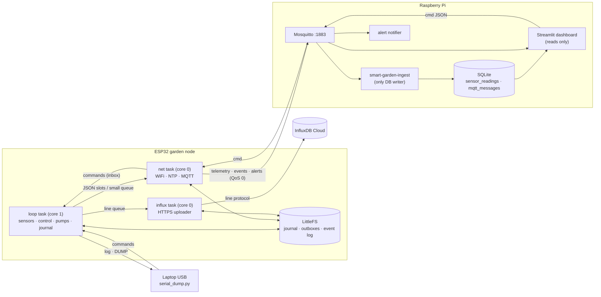
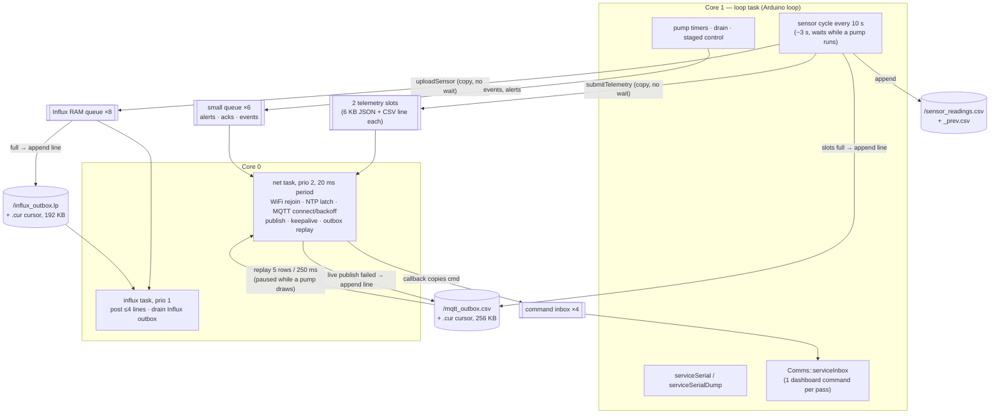
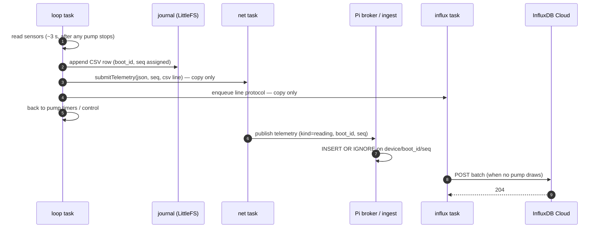
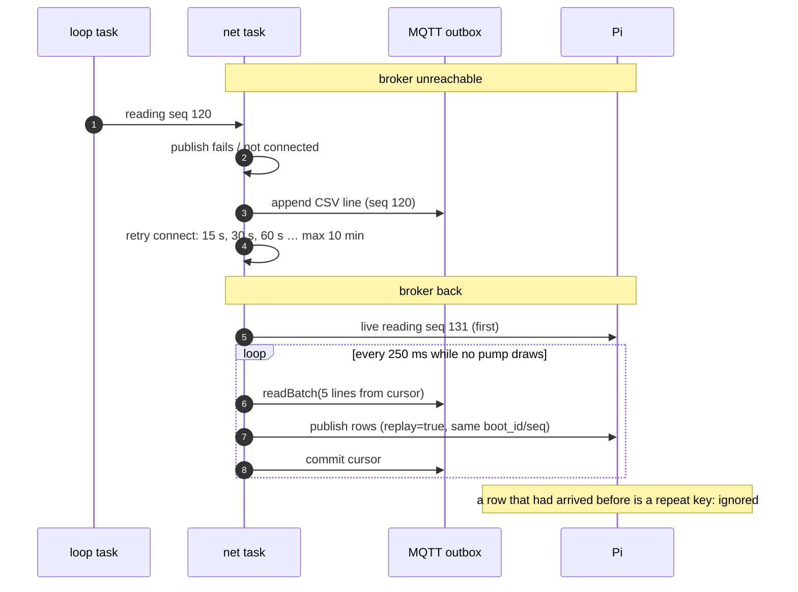
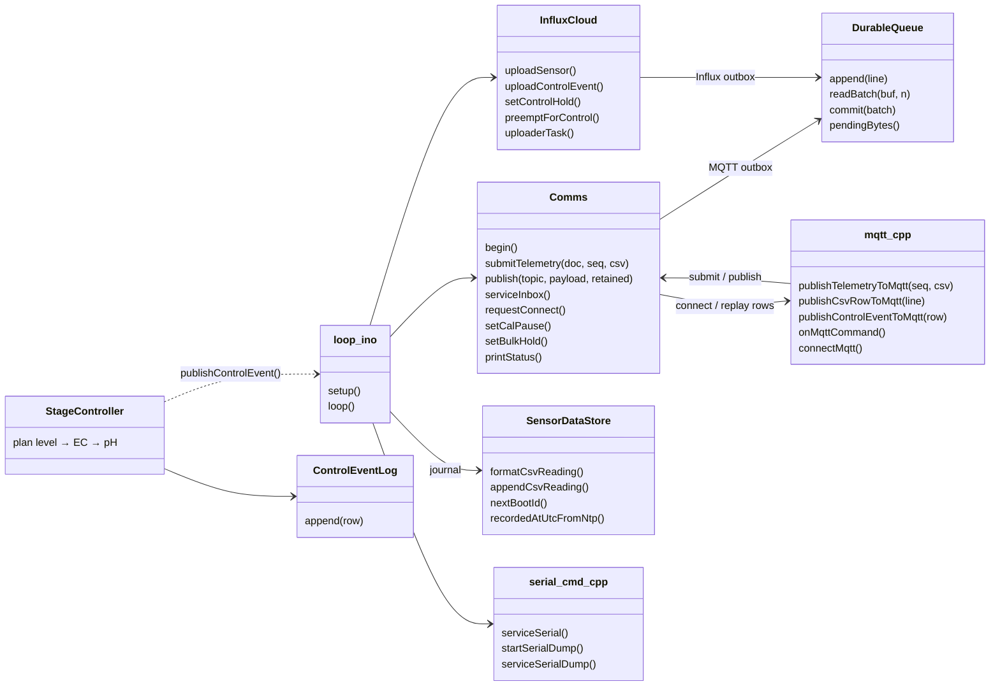
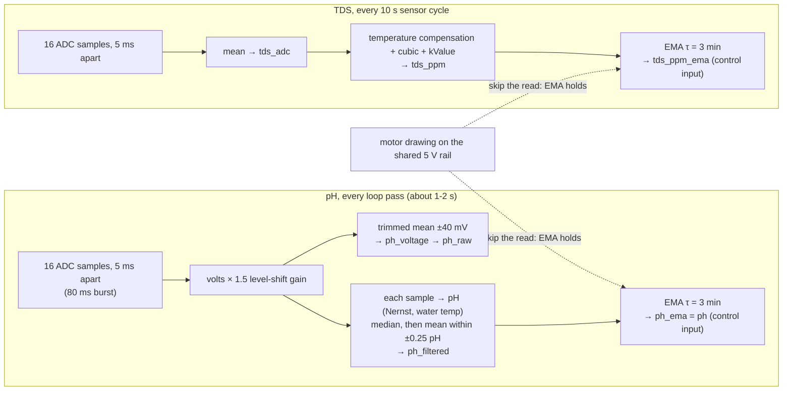

# Smart Hydroponic Garden

## Prototype board iterations

| Iteration | Interconnect | Notes |
| --- | --- | --- |
| **1 — plug-in breadboard** | Jumpers on a solderless breadboard | Fast bring-up; flaky contacts under pump vibration |
| **2 — soldered breadboard (current)** | **JST-XH 2.5 mm** plugs soldered on the main protoboard | Serviceable harnesses; ambient board remote |

### Iteration 2 — grow light + JST-XH harnesses

Iteration 2 moves from plug-in breadboard to a **soldered breadboard**
(protoboard) on the main controller, adds the **WS2812B grow light**, and
splits **ambient sensing** onto a daughterboard so readings reflect plant-room
conditions — not the inside of the ABS project box. All main-board I/O that
leaves the box uses **JST-XH 2.5 mm** connectors (soldered).

| Change | Detail |
| --- | --- |
| Mechanical | Soldered breadboard main board; pumps drilled through ABS lid |
| Connectors | JST-XH 2.5 mm: pumps, sensors, grow light, ambient, 5 V rail |
| Grow light | 2 m WS2812B strip, 120 LEDs (5×24 serpentine), GPIO **27** |
| Ambient board | Separate soldered breadboard; **JST-XH 7-way** harness to main |
| DHT11 data | **GPIO 16** (board label **RX2**) — moved off GPIO 15 (boot strap) |
| pH-down pump | **GPIO 5** (PCB D5); was GPIO 17 on the breadboard prototype. Offline 15-19 Oct (D5 trace broken); auto pH-down re-enabled in 1.9.27 (`PH_DOWN_PUMP_OFFLINE 0`) |
| pH signal | Discrete **10 kΩ / 20 kΩ** divider → GPIO 32 (replaces Duinotech RX 50/50) |
| Spectrum | Blurple tuned for **basil & lettuce** (veg leafy greens) |
| Photoperiod | **ON 22:00 → 14:00 UTC** (16 h) = 08:00 → 00:00 AEST / 09:00 → 01:00 AEDT; dark the other 8 h |
| Power | Two bucks from shared **12 V 5 A**: board 5 V rail + LED 5 V / 3 A |
| Telemetry | `grow_light_on`, `grow_light_want_on`, `grow_light_next_change_s`, `grow_light_mode`, … |

### Mechanical layout (iteration 2)

```
┌─────────────────────────────────────┐   JST-XH 7-way    ┌──────────────────┐
│  ABS project box (main electronics) │◄─────────────────►│ Ambient sensors  │
│  • ESP32 + soldered breadboard      │                   │ daughterboard    │
│  • JST-XH plugs (pumps, sensors,    │                   │ • DHT11          │
│    grow light, 5 V rail)            │                   │ • LDR            │
│  • Pumps (lid-mounted)              │                   │ • PAS CO2 (I2C)  │
│  • Water sensors (pH, TDS, level,   │                   │ (room air)       │
│    DS18B20)                         │                   └──────────────────┘
│  • Grow-light data (GPIO 27) out    │
└─────────────────────────────────────┘
         │
         └── WS2812B panel above plants (separate 5 V buck via JST-XH)
```

#### Main-board JST-XH connector map (iteration 2)

| Connector | Ways | Goes to | Typical pins |
| --- | --- | --- | --- |
| Pump ×4 | **3-way** each | Water / nutrient / pH-up / pH-down servo | Signal, 5 V, GND |
| Grow-light power (from buck) | **3-way** | LED buck → main board / strip power feed | +5 V, GND (+ spare / sense as wired) |
| Grow light (to strip) | **3-way** | WS2812B panel | +5 V, GND, **DIN** (GPIO 27 via series R) |
| Water temperature | **3-way** | DS18B20 | VCC, GND, DATA (GPIO 4) |
| pH sensor | **3-way** | SEN0169 board | 5 V, GND, SIG → 10 kΩ/20 kΩ divider → GPIO 32 |
| Grove water level | **4-way** | Grove I2C level stick | Grove VCC / GND / SDA / SCL |
| Grove TDS | **4-way** | Grove TDS v1.0 | VCC, GND, SIG (GPIO 35); **1 pin NC** |
| Ambient module | **7-way** | Ambient daughterboard | See table below |
| Board 5 V rail | **2-way** | Second buck → main-board 5 V rail | +5 V, GND |

Label both ends of every harness. Pin order on the ambient 7-way follows the
**current prototype** (below) — re-check with a meter before swapping boards.

The **ambient sensors board** stays outside the enclosure so temperature,
humidity, CO₂, and ambient light match the grow space. Tank chemistry sensors
stay with the reservoir electronics on the main board.

See **[Ambient sensors daughterboard](#ambient-sensors-daughterboard--jst-xh-7-way)**,
**[Grow light (iteration 2)](#9-grow-light-ws2812b-strip--iteration-2)**, and
**[ESP32 pin notes (bootstrap)](#esp32-pin-notes-bootstrap-pins)**.

## Wiring notes

This project runs on an ESP32 and reads data from several sensors. The sketch prints readings to the Arduino Serial Monitor at 115200 baud and can publish the same telemetry to the Raspberry Pi IoT dashboard over MQTT.

Pump calibration (Serial `CAL` or dashboard **Calibration → Peristaltic pumps**
cup wizard into a 10 mL cup) and the **live chemistry
controller** (adaptive proportional + dead band + online gain tuning) are
documented in **[CONTROL_SYSTEM.md](CONTROL_SYSTEM.md)**. The first Kratky
prototype post-mortem and retired bang-bang / `ControlLaw` notes are in
**[CONTROL_REPORT.md](CONTROL_REPORT.md)**.

This iteration is **DWC only** (air stone). Bring-up on Serial (115200, Newline):

1. Calibrate pumps (`CAL WATER`, `CAL PH_*`; nutrient later).
2. Calibrate chemistry probes: `ENTERPH` (4.00 / 9.18) and `ENTERTDS` with
   salt water + TDS pen (or 707 ppm standard) — see wiring sections below.
3. Boot starts in **`MODE FILL`**: other sensors paused; only water level
   prints. **Fill the tank by hand** until water **just touches** the net
   pots, then `CONFIRM` (saves `/net_pot_touch.txt`) → **`MODE PRIMING`**.
4. Priming: auto **pH only** (no nutrients). Soak rockwool by hand when pH
   is in band.
5. `MODE SEEDLING` holds level near touch and runs pH only. Later:
   `MODE VEGETATIVE` unlocks EC (800–1200 ppm); `MODE HARVEST` deepens
   the air gap. (`MODE FLOWERING` is an alias for vegetative.)

pH bottles are **600 mL**, nutrient and the water jug are **1 L**. Empty
bottles stop auto dosing (`FILL` on Serial).

### InfluxDB Cloud (no Raspberry Pi)

With `ENABLE_INFLUXDB 1` and `ENABLE_MQTT 0` in `embedded-smart-garden.ino`, the ESP32
uploads every **10 s** sensor sample and every **control event** (doses with mL)
over HTTPS. Local CSV on LittleFS is **always** written as backup. Every line
carries a `firmware_version` field.

**Checking uploads.** Serial `INFLUX` prints the queue depth, whether uploads
are held, lines uploaded/dropped since boot, the last success and the last
HTTP code. Live MQTT telemetry carries the same numbers in `influx`
(`queued`, `hold`, `ok_ago_s`, `uploaded`, `dropped`, `last_http`), and
`health.influx` turns red when nothing has been written for 90 s. The TLS
handshake is capped at 8 s (`setHandshakeTimeout` takes **seconds**; before
1.6.2 it was passed ms, so one stalled handshake could block uploads for
hours). Uploads pause only while a motor draws on the shared rail.

**One-time setup**

1. In [InfluxDB Cloud](https://cloud2.influxdata.com): **Load Data → Buckets → Create bucket**  
   Name it `smart-garden` (or change `INFLUX_BUCKET` in `secrets.h`).
2. **Load Data → API Tokens → Generate API token**  
   - Permissions: read/write on that bucket  
   - Copy the token (shown once).
3. Note your **cluster URL** (e.g. `https://us-east-1-1.aws.cloud2.influxdata.com`)  
   and **Organization name or ID** (ID is safer if the name has spaces).
4. In `secrets.h` set `INFLUX_URL`, `INFLUX_ORG`, `INFLUX_BUCKET`, `INFLUX_TOKEN`.
5. Flash. Serial should show `[INFLUX] Cloud upload enabled → bucket smart-garden`,
   then `[INFLUX] uploader task started`. Each sample prints
   `[INFLUX] sensor_reading queued` immediately. A later
   `[INFLUX] uploaded N queued line(s)` means the cloud accepted them.
   `[INFLUX] upload preempted for control` means a pump or a manual cycle
   interrupted the handshake; those lines stay queued and are retried.

**Measurements**

| Measurement | Contents |
| --- | --- |
| `sensor_reading` | All sensors every 10 s; tag `stage`; **raw + filtered** where applicable: `ph_raw`, `ph_filtered` (burst), `ph_ema` (control low-pass: Butterworth-2 at 2 mHz from 1.9, 3 min EMA before; held while a pump draws), `ph` (= `ph_ema`, the control input), `ph_voltage`, `ph_temp_c` / `ph_comp_factor` (Nernst), `water_level_pct` (trusted), `water_level_raw_pct`, plus `tds_ppm` (burst), `tds_ppm_ema` (same control low-pass; control input), `tds_ppm_nutrient` / `tds_ph_salt_ppm` (pH-reagent salt observer), `grow_light_on`, **power health**: `uptime_ms`, `reset_reason`, `boot_count`, `brownout_count`, `last_reset_brownout`, `rail_mv` (optional ADC divider), `free_heap_b`, `wifi_rssi_dbm`, … |
| `ambient_reading` | Ambient daughterboard only (`ambient_sensor_test` sketch): `ambient_temp_c`, `ambient_humidity_pct`, `light_adc`, `co2_ppm`, `*_ok` flags |
| `control_event` | Doses, level checks, pH re-checks; `ph_dose_ml`, `ec_dose_ml`, `event` tag |

**Export for MATLAB**

- UI: **Data Explorer** → query → **CSV** download.  
- Example Flux (sensor trace):

```flux
from(bucket: "smart-garden")
  |> range(start: -24h)
  |> filter(fn: (r) => r._measurement == "sensor_reading")
  |> pivot(rowKey: ["_time"], columnKey: ["_field"], valueColumn: "_value")
```

- Dose events:

```flux
from(bucket: "smart-garden")
  |> range(start: -24h)
  |> filter(fn: (r) => r._measurement == "control_event")
  |> pivot(rowKey: ["_time"], columnKey: ["_field"], valueColumn: "_value")
```

In MATLAB: `T = readtable("sensor_reading.csv");` then `plot(T._time, T.ph)`.

**Dashboard data path:** time-series sensor and control data are uploaded to
**InfluxDB Cloud** (`sensor_reading`, `control_event`, `ambient_reading`).
That is the right place for charts, historical analysis, and Grafana / Data
Explorer. A **local Raspberry Pi dashboard** (optional, `ENABLE_MQTT 1`) uses
**MQTT** for near-real-time JSON on the LAN — better for live tiles, not for
long-term storage. Serial logs and LittleFS CSV remain on-device backups; they
are not streamed to the dashboard.

### Data paths and firmware architecture (1.8.0)

Every reading leaves the ESP32 through three outlets. Each has one job, and
none of them can hold up the control loop or block the others.

| Outlet | Job | Transport | When | Loss / duplicates |
| --- | --- | --- | --- | --- |
| **LittleFS journal** `/sensor_readings.csv` | Ground truth on the device | Flash append (loop task) | Every reading, always | Kept until rotated (2 × 640 KB, about 1.5 days); `DUMP` reads it |
| **MQTT → Pi** `smart-garden/<id>/telemetry`, `/events` | Live dashboard and the Pi's SQLite history | Network task, LAN | Live; misses are replayed from the MQTT outbox | Each reading carries `boot_id` + `seq`; the Pi stores one row per key |
| **InfluxDB Cloud** `sensor_reading`, `control_event` | Long-term cloud history, Data Explorer, MATLAB exports | Influx task, HTTPS | Queued; overflow goes to the Influx outbox | Every point has its own ms timestamp, so a resend overwrites the same point |
| **Serial (USB)** | Human log, commands, on-request `DUMP` of the journal | UART, 4 KB TX buffer | Logs always; data only when asked | `DUMP` is framed (line no + CRC); `scripts/serial_dump.py` verifies and resumes |

Serial is deliberately **not** a third streaming uplink. The journal already
holds every reading, so Serial is for diagnostics and a verified copy of the
journal when the network was down for longer than the outboxes hold.

#### System context



#### Tasks, queues and who may block



Rules that keep the three paths from interfering:

- **The loop task never opens a socket.** It copies a finished payload into a
  slot or queue and returns. If a slot is not free it appends the reading's
  journal line to the MQTT outbox; nothing waits.
- **Only the net task touches `mqttClient` and WiFi** (join, rejoin, NTP,
  connect, publish, keepalive, replay). PubSubClient is not thread-safe.
- **Only the influx task touches the TLS client.** `preemptForControl()` still
  closes a handshake when a dose starts, and uploads wait while a motor draws
  on the shared 5 V rail. The MQTT outbox replay pauses under the same hold.
  Live MQTT readings do not pause; they are small.
- **Dashboard commands run on the loop task**, exactly like Serial commands:
  the MQTT callback only copies the payload into the inbox.
- **The outboxes are append-only with a persisted read cursor**
  (`shared/durable_queue.h`). A writer never waits behind a long copy, and a
  reset resumes where delivery stopped. Delivery is at-least-once; the
  receivers de-duplicate (see *Reading identity*).
- **`DUMP` never blocks.** It writes a few whole lines per loop pass and only
  while the 4 KB TX buffer has room, so a 640 KB journal takes about a minute
  with pumps and sensors still serviced.

#### One reading



#### Outage and catch-up



#### MQTT link

```mermaid
stateDiagram-v2
  [*] --> WifiDown
  WifiDown --> WifiUp: connectWifi() (net task; retried every 30 s)
  WifiUp --> Connecting: due (backoff elapsed or MQTT CONNECT)
  Connecting --> Connected: connect ok, subscribe cmd
  Connecting --> Backoff: fail (15 s → ×2 → 10 min)
  Backoff --> Connecting: timer / MQTT CONNECT
  Connected --> Backoff: drop detected
  Connected --> Paused: pump CAL starts
  Paused --> Connecting: CAL finishes or aborts
  WifiUp --> WifiDown: WiFi lost
  Connected --> WifiDown: WiFi lost
```



Before 1.8.0 MQTT was tried once at boot and never again without a Serial
`MQTT CONNECT` (see [`docs/mqtt_connect_policy.md`](docs/mqtt_connect_policy.md)).
The worry was reconnect attempts stalling the loop and Influx. With the
connect on its own task and a 15 s → 1 min backoff (10 min before 1.9.25),
neither applies. The backoff restarts when WiFi rejoins.

#### Reading identity

`boot_id` is a counter in `/boot_id.txt`, incremented once per boot (unlike
`boot_count`, which restarts after a power loss). `seq` counts journal rows
within a boot. The pair is written to:

| Where | Fields |
| --- | --- |
| Journal CSV | columns `boot_id`, `seq` (last two) |
| MQTT telemetry | `kind` (`reading` or `status`), `boot_id`, `seq`; replay adds `replay: true`, `uptime_ms` |
| MQTT events | `kind: control_event`, `boot_id`, `event_seq` |
| Influx `sensor_reading` | fields `boot_id`, `seq` |
| Pi SQLite | `reading_key = "<device>/<boot_id>/<seq>"`, unique; `mqtt_messages.msg_key` likewise |

A status snapshot sent right after a dashboard command has `kind: status` and
no `seq`; every one is kept. A gap in `seq` within one `boot_id` on the Pi
means a reading was lost on the live path. The journal still has it, and
`scripts/serial_dump.py` recovers it.

**Delivery semantics.** MQTT is QoS 0 (PubSubClient). A publish that returns
true has left the ESP32's TCP buffer, but the broker has not confirmed it, so
a reading sent in the last seconds before a silent drop can be lost from the
live path. It is still in the journal. Everything else is at-least-once, with
receivers ignoring repeats.

#### Time

The net task latches SNTP time into the `millis()` → epoch mapping as soon as
SNTP answers, and again every 6 h (crystal drift is a few seconds a day).
Readers use `ntpSnapshot()` / `recordedAtUtcForUptime()`, which copy the
mapping under the same lock, so a re-latch cannot pair a new epoch with an old
`millis`. The conversion is wrap-safe across the 49.7-day `millis()` rollover.
Before NTP answers, journal rows have an empty `recorded_at_utc` and Influx
points are not queued; a timestamp of uptime would land in 1970.

#### Flash budget (LittleFS, about 1.9 MB)

| File | Cap | Holds |
| --- | --- | --- |
| `/sensor_readings.csv` + `_prev.csv` | 2 × 640 KB | about 1.5 days of readings |
| `/mqtt_outbox.csv` | 256 KB | about 2.5 h of readings the Pi missed |
| `/influx_outbox.lp` | 192 KB | about 40 min of Influx lines beyond the RAM queue |
| `/control_events.csv` | uncapped, ~3 KB/day | every control decision |
| calibration / stock / level files | < 4 KB | settings |

When free space drops below 32 KB, the archived journal is removed first and
the live journal last. The outboxes refuse new lines at their caps; the
journal still has those rows.

#### Code structure



| File | Owns | Runs on |
| --- | --- | --- |
| `embedded-smart-garden.ino` | `setup()`, `loop()` order, sensor-cycle scheduling, holds | loop |
| `comms.cpp` | net task: WiFi rejoin, NTP latch, MQTT connect/backoff, slots, queues, outbox replay, `NET` status | net (API called from loop) |
| `mqtt.cpp` | building telemetry / alert / event / replay JSON, dashboard command handler | loop (builders, handler); net (`connectMqtt`, `publishCsvRowToMqtt`) |
| `network.cpp` | WiFi profiles and join, SNTP start, Influx point building, control-event fan-out | net (join); loop (Influx, events) |
| `shared/influx_cloud.h` | line protocol, RAM queue, Influx outbox, uploader task | loop (enqueue); influx task |
| `shared/durable_queue.h` | append-only outbox with persisted cursor | any task (mutex) |
| `csv_log.cpp` + `shared/sensor_data_store.h` | journal schema, rotation, boot id, row formatting | loop |
| `serial_cmd.cpp` | Serial commands, non-blocking framed `DUMP` | loop |
| `sensors.cpp`, `control_loops.cpp`, `staged_control.cpp`, `pump_cal.cpp`, `shared/*_control_loop.h`, `shared/stage_controller.h` | sensing, filters, pumps, staged control, calibration | loop |

Serial commands for this layer: `NET` (or `MQTT`) shows WiFi, NTP, MQTT,
backoff and outbox counters. `MQTT CONNECT` tries now. `INFLUX` shows the
uploader and its outbox. `DUMP SENSORS | CTRL | PREV | OUTBOX [RAW] [FROM n]`
and `DUMP STOP` read files from flash.

**Scheduling inside `loop()`**, each pass in order:

1. `serviceSerial()`, then `serviceSerialDump()` (a few framed lines if TX has room).
2. CAL owns the board: return early (the net task keeps WiFi up; MQTT is paused).
3. `Comms::serviceInbox()`: at most one dashboard command.
4. Drain / over-full level first, then a 2 s water-level poll.
5. Pump timers (`updateWaterRefillPump`, `updateManualPrime`,
   `updatePHControl`, `updateNutrientControl`), then `serviceStagedControl`.
6. About every 10 s, the sensor cycle (level, probes, DHT11, CO2), unless a
   motor is drawing on the shared rail (it waits at most 30 s). It journals the
   row, hands MQTT the JSON and Influx the line, and returns. About 3 s.
7. Set the Influx hold and the MQTT replay hold from "a motor is drawing".

**Influx queue.** Callers copy a line into an 8-deep RAM queue (1536 bytes
per slot) under a mutex and return. When it is full the line goes to
`/influx_outbox.lp` instead of being dropped, and the uploader drains that
file whenever the RAM queue is empty. The uploader posts at most four lines
per attempt, only while the control hold is clear. A timeout keeps the batch
and retries after a short backoff. HTTP 400/401/403/404 drops that batch so
one rejected line cannot block the rest.

**Preempt.** `preemptForControl()` sets the hold and, if a handshake is in
progress, closes that TLS socket from the loop task. The uploader restores the
batch and waits. The hold covers the whole calibration session, fill mode, a
soft prime, and any time a shared-5 V pump is drawing. `startStagedAction` and
`startManualPrime` preempt before the servo leaves stop.

Serial lines that matter: `[NET] MQTT reading seq=N published`,
`[NET] MQTT retry in N s`, `[NET] MQTT outbox replay complete`,
`[INFLUX] sensor_reading queued`, `uploaded N queued line(s)`,
`uploaded N outbox line(s)`, `upload preempted for control`,
`write rejected — dropped that batch`.

A code review of the data paths (what changed in 1.8.0, and what is still
open) is in [`docs/data_path_review_2026-10-05.md`](docs/data_path_review_2026-10-05.md).

### Ambient sensor module test (`ambient_sensor_test/`)

Flash **`ambient_sensor_test/ambient_sensor_test.ino`** to verify the
daughterboard harness without tank chemistry or pumps:

1. Copy `secrets.h.example` → `secrets.h` (repo root) with WiFi + Influx credentials.
2. Install **DHT sensor library** and **PAS CO2** (Infineon) in Arduino IDE.
3. Open the sketch folder, upload at **115200** (Newline).
4. Serial: `READ` (one shot), `INFLUX` (connectivity test), or wait for automatic
   uploads every **30 s**.

Influx measurement **`ambient_reading`** fields: `ambient_temp_c`,
`ambient_humidity_pct`, `light_adc`, `co2_ppm`, plus `dht_ok` / `ldr_ok` /
`co2_ok` booleans. Example Flux:

```flux
from(bucket: "smart-garden")
  |> range(start: -1h)
  |> filter(fn: (r) => r._measurement == "ambient_reading")
  |> pivot(rowKey: ["_time"], columnKey: ["_field"], valueColumn: "_value")
```

Shared read logic: `shared/ambient_sensors.h`.

**Toggles** (top of `embedded-smart-garden.ino` after `secrets.h`):

```cpp
#define ENABLE_MQTT 0
#define ENABLE_INFLUXDB 1
```

Re-enable Pi MQTT later by flipping these back.

### MQTT dashboard publishing

With `ENABLE_MQTT` set to `1` in `garden.h`, the network task joins WiFi and
connects to the broker. If the broker is down it retries with a backoff
(15 s, doubling to 1 min, restarting when WiFi rejoins); Serial
**`MQTT CONNECT`** tries at once. If the configured broker does not answer,
the same attempt tries the Pi's mDNS name (`MQTT_BROKER_MDNS_HOST`,
`smar-gardon.local`). Readings
the live publish missed are replayed from the MQTT outbox when the link is
back. See *Data paths and firmware architecture* above and
[`docs/mqtt_connect_policy.md`](docs/mqtt_connect_policy.md).

Publishes JSON to:

`smart-garden/garden-node-01/telemetry`

and accepts commands on:

`smart-garden/garden-node-01/cmd`

**Local PC (no Raspberry Pi):** run the dashboard from
`~/dev/smart-garden-iot-dashboard` with `./scripts/run-local-dashboard.sh`.
Set `MQTT_BROKER_HOST` in `secrets.h` to this computer's **WiFi LAN IP** on
`HOME_WIFI` (ChromeOS: Settings → Network). Do **not** use the Linux
container IP (`100.115.x.x`). Port-forward TCP **1883** into ChromeOS Linux
if you are in Crostini. Dashboard sidebar host stays `localhost`.

**Raspberry Pi hub:** set `MQTT_BROKER_HOST` to the Pi's mDNS name
(`smar-gardon.local`) or its LAN IP. Dashboard on the Pi also uses `localhost`.

**Home and campus WiFi.** `WIFI_NETWORKS` in `secrets.h` lists every network
the node may join; at each connect it scans and joins the strongest one it
knows. Two are set up:

| Network | Auth | MQTT broker |
| --- | --- | --- |
| `HOME_WIFI` | WPA2-PSK | `MQTT_BROKER_HOST` (the Pi's DHCP address, `192.168.4.135` since 19 Oct; `smar-gardon.local` if it stops answering) |
| `UniWireless` | WPA2-Enterprise PEAP / MSCHAPv2, UniMelb login | `smar-gardon.local` (mDNS; campus DHCP gives the Pi a different address) |

Each profile's optional last field, `mqttBrokerHost`, sets the broker for that
network; without it the node uses `MQTT_BROKER_HOST`. Serial prints
`WiFi connected - SSID … IP … MQTT broker …` after each join. The ESP32 joins
UniWireless without checking the RADIUS server certificate. With the
anonymous identity left empty it sends the username as the outer identity
(1.9.25; before, the core sent none), the same as the Pi's NetworkManager.

The Pi needs the same two networks (NetworkManager on Raspberry Pi OS). It
keeps `HOME_WIFI`; UniWireless is added as a system connection
(`/etc/NetworkManager/system-connections/UniWireless.nmconnection`, root-only,
PEAP / MSCHAPv2 with the credentials from `secrets.h`). NetworkManager joins
whichever of the two is in range.

On campus, check from Serial that the node resolves `smar-gardon.local` and
connects to MQTT. UniWireless may block traffic between wireless clients or
multicast (mDNS). If `mDNS lookup failed` and `DNS lookup failed` appear,
read the Pi's campus address with `hostname -I` and set it as
`mqttBrokerHost`. If MQTT still cannot connect (`state -2`), the network is
isolating clients and the Pi and ESP32 need a shared network instead (for
example a hotspot on the Pi).

UniWireless blocks mDNS, so `smar-gardon.local` never resolves there, and
inside the project box the ESP32 hears UniWireless at only −86 to −91 dBm
and often cannot join.

**Serial link to the Pi (1.9.29).** With the ESP32's USB cable in the Pi,
`scripts/serial_mqtt_bridge.py` (dashboard repo, `smart-garden-serial-bridge`
service) carries MQTT over the cable. The bridge sends `@LINK <epoch>` every
5 s. While those arrive and MQTT is down, the node writes each publish as a
`@MQ <r|-> <topic> <payload>` line and the bridge publishes it to Mosquitto;
dashboard commands come back as `@CMD <json>` lines and run like MQTT
commands, in standby too (power on). MQTT is used whenever it is up, and
the bridge forwards commands only while the node answers `@LS serial`, so
nothing runs twice. With the link up, WiFi is retried every 10 min instead
of every 30 s (a failed join holds the network task for over a minute).
The Pi's epoch sets the clock when SNTP is out of reach. `NET` prints the
link state. The rest of Serial (the log) goes to
`data/esp32_serial.log` on the Pi. `scripts/flash_esp32_from_pi.sh
<app.bin>` flashes over the same cable.

pH probe calibration (4.00 / 9.18) is available on Serial (`ENTERPH` …) and
on the dashboard **Calibration** tab over MQTT (`{"cmd":"ph_cal",…}`).
Grove TDS calibration (salt water or 707 ppm standard) uses Serial
(`ENTERTDS` / `CALTDS <ppm>` / `EXITTDS`) or MQTT `{"cmd":"tds_cal",…}`.
Peristaltic pumps use the cup wizard on **Calibration → Peristaltic pumps**
(`{"cmd":"pump_cal",…}`) or Serial `CAL WATER` / `CAL PH_UP` / ….
Grow stage is set from **Overview → Grow stage**
(`{"cmd":"stage","value":"seedling|vegetative|…"}`) or Serial `MODE …`.

```text
smart-garden/garden-node-01/telemetry   readings (kind=reading, boot_id, seq) and status snapshots
smart-garden/garden-node-01/events      control events (kind=control_event, boot_id, event_seq)
smart-garden/garden-node-01/alerts      (retained: cal / stock banners)
smart-garden/garden-node-01/ack         command acks (camera flash)
smart-garden/garden-node-01/cmd         dashboard → ESP32
```

Before flashing:

- Copy `secrets.h.example` to `secrets.h`
- Fill in `WIFI_NETWORKS` (home PSK password; UniMelb username and password)
- Set `MQTT_BROKER_HOST` to the Pi's address or mDNS name (`smar-gardon.local`).
  The sketch resolves this with ESPmDNS. If connect still fails with state `-2`,
  fall back to the Pi LAN IP from `hostname -I`.
- Do **not** use `localhost` (that is the ESP32 itself)

`secrets.h` is gitignored and should not be committed.

On the Raspberry Pi, enable the LAN broker once:

```bash
./scripts/setup-pi-mqtt-broker.sh
```

Confirm mDNS from another device: `ping smart-garden.local`

In the Streamlit sidebar on the Pi choose **MQTT** as the data source
(`localhost:1883`, topic `smart-garden/+/telemetry`). Subscribe the alert
banner to `smart-garden/+/alerts` (retained).

#### Dashboard status: `health`, `health_msg`, `sched`

Every telemetry frame (firmware 1.6+) carries a status block for the
dashboard's **Sensor & actuator status** lights and the **Readings, checks
and dosing** panel:

```json
"health": {"ph": "fault", "tds": "warming", "water_level": "init",
           "water_temp": "ok", "ambient": "ok", "co2": "ok", "light": "ok",
           "water_pump": "hold", "nutrient_pump": "ok", "ph_up_pump": "ok",
           "ph_down_pump": "ok", "grow_light": "ok", "auto_control": "ok"},
"health_msg": {"ph": "no valid pH (raw -9.83 @ 0.012 V) — probe unpowered? check 5 V rail"},
"sched": {"read_s": 10, "read_in_s": 4, "activity": "idle", "wait_s": 0,
          "level": {"on": true, "every_s": 7200, "in_s": 3600,
                    "topup_at_pct": 72, "refill_to_pct": 78,
                    "hold": "water level init required"},
          "ec": {"on": true, "every_s": 7200, "in_s": 0, "dose_below": 750,
                 "min": 800, "max": 1200, "high_above": 1250},
          "ph": {"on": true, "every_s": 7200, "in_s": 900,
                 "up_below": 5.4, "down_above": 5.9, "min": 5.5, "max": 5.8}}
```

| `health` value | Light | Meaning |
|----------------|-------|---------|
| `ok` | blue | Reading valid / actuator available |
| `fault` | red | Invalid reading, or a bottle empty (pump stopped) |
| `init` | amber | Water level stick needs lift-and-lower after a restart |
| `warming` | amber | pH/TDS EMA collecting its first 60 s |
| `hold` | amber | Actuator or auto control held (uncalibrated pump, level not initialised, `AUTO PAUSE`, FILL/CAL) |
| `off` | grey | Disabled in firmware |

The dashboard shows grey for every device while no telemetry arrives.

`sched` times are seconds from when the frame was sent. `in_s = 0` means the
check is due and runs on the next control pass (once the controller is not
busy). `activity`/`wait_s` report a settle in progress
(`wait_water_settle`, `wait_ec_settle`, `wait_ph_settle`); every check waits
for it. `hold` names the first reason that loop will not dose.
`cycle_requested` is true while a manual cycle (`CYCLE` / MQTT
`{"cmd":"cycle"}`) is queued, and `ph_after_ec` while a settled nutrient dose
is waiting on its pH check. The level
threshold is `topup_at_pct`: a top-up happens when the level is at or below
it (drawdown from fill_0 greater than target + tolerance), back to about
`refill_to_pct`.

Payload size is 4.6 to 6.2 kB, depending on the health messages. The telemetry buffer and PubSubClient buffer
are `MQTT_TELEMETRY_MAX_BYTES` (8192) in `garden.h`.

#### MQTT pump calibration alerts

Every telemetry frame includes:

| Field | Meaning |
| --- | --- |
| `cal_alert` | e.g. `uncal:water,uncal:ph_up` or empty when all pumps have rates |
| `cal_needed` | `true` if water / pH (and nutrient when dosing is on) still need `CAL` |
| `water_calibrated` / `nutrient_calibrated` / `ph_up_calibrated` / `ph_down_calibrated` | per-pump booleans |
| `pumps_calibrated` | count 0–4 |
| `alerts` | array of active strings (`cal_alert`, `stock_alert`, `action:run_pump_cal`) |
| `stock_alert` | bottle `low:` / `empty:` tags (unchanged) |
| `pump_cal_*` | live cup-wizard state (`active`, `state`, `pump`, `message`, run progress, …) |
| `water_ml_per_s` / `*_ml_per_burst` | saved rates when calibrated |

Dashboard **Calibration → Peristaltic pumps** drives the wizard with
`{"cmd":"pump_cal","action":"enter|prime|run|stop|volume|…"}` (cup must be
confirmed before **Run**). Serial `CAL …` still works the same way.

#### MQTT connect troubleshooting (Serial Monitor)

| Symptom | Likely cause |
| --- | --- |
| `MQTT connect failed - state -2` | Wrong host, DNS failure, broker not listening on LAN, or firewall |
| `DNS lookup failed` | Change `MQTT_BROKER_HOST` to a numeric LAN IP |
| WiFi connected but MQTT fails | Broker only bound to localhost — install `mosquitto-pi.conf` / use Docker |
| `[NET] MQTT retry in N s` | Broker unreachable; the net task keeps retrying (15 s doubling to 10 min). Serial `MQTT CONNECT` tries now; `NET` shows the outbox |
| `[NET] MQTT outbox replay complete` | Readings missed while MQTT was down have been sent to the Pi |
| Dashboard connected, no readings | ESP32 not publishing, or topic mismatch |

Libraries required in the Arduino IDE Library Manager:

- PubSubClient
- ArduinoJson
- FastLED (grow light WS2812B on GPIO 27; `setMaxPowerInVoltsAndMilliamps(5, 2200)`)
- (existing sensor libraries already used by this sketch)

The Pi dashboard project lives at `smart-garden-iot-dashboard` and expects the hydroponic payload fields described in that repo's README.

### CSV log (SQLite-ready)

The ESP32 appends every reading to `/sensor_readings.csv` on LittleFS (the
journal: on-device ground truth). At 640 KB it is archived to
`/sensor_readings_prev.csv`, and a file with an older column layout is
archived the same way at boot instead of deleted. A reading whose live MQTT
publish failed goes to `/mqtt_outbox.csv` (the same line, no header, 256 KB)
and is replayed to the Pi when MQTT is back. Copy files off with
`python scripts/serial_dump.py sensors out.csv` (verified, resumable). The
columns are snake_case so they import straight into SQLite:

- `recorded_at_utc` is ISO-8601 UTC (`YYYY-MM-DDTHH:MM:SSZ`) after NTP sync;
  empty before that (SQL NULL)
- `uptime_ms` is `millis()` since boot, not a wall clock
- missing / failed sensors are empty cells, not `-1` / `-127`
- pump columns are `0` / `1`
- `boot_id`, `seq` (last two columns, 1.8.0+) identify the reading in MQTT,
  Influx and the Pi's SQLite
- grow light columns (`grow_light_on`, `grow_light_brightness_pct`,
  `grow_light_animating`) are `0` / `1` or empty when disabled
- filtered sensors export **raw and filtered** separately:
  `water_level_pct` (trusted) + `water_level_raw_pct`; `ph` (raw average) +
  `ph_filtered` (outlier-rejected burst) + `ph_ema` (3 min EMA used for
  control); `tds_ppm` (burst) + `tds_ppm_ema`; `ph_voltage` is the raw board
  voltage; `ph` / `ph_raw` are Nernst-compensated from DS18B20 water temp

The Pi's long-term store is SQLite, written only by the dashboard repo's
`smart-garden-ingest` service (one row per `boot_id`/`seq`). Do not rename
these columns; the replay parser and the Pi read them by name and position.

### Important power note

**Which sensors need the board 5 V rail.** Only the **pH probe (SEN0169)** and
the **CO2 emitter (PAS CO2 VDD5)** run from the board 5 V rail (as do the
pumps). The **TDS probe runs from the ESP32 3.3 V**, like the water level
stick, DS18B20, DHT11 and LDR, so it keeps reading with the rail off (USB
only). With the rail off, expect a **pH fault** (red, dosing held) and a
**CO2 fault** (invalid ppm). Pumps cannot run either.

If you plug in the USB cable and remove the VIN connection, the ESP32 will still be powered from USB. In that case, the board should continue running normally and the serial output should still appear in the Arduino IDE Serial Monitor.

## Step-by-step wiring guide

### 1) ESP32 power
1. Connect the ESP32 USB cable to your computer for programming and serial monitoring.
2. If you are powering from VIN, connect the ESP32 VIN pin to a regulated 5V supply.
3. Keep the ESP32 GND connected to the common ground for all sensors.

### 2) Grove water level sensor wiring

Plugs into the main board via a **JST-XH 4-way** (full Grove I2C pinout).

1. Connect the Grove water level sensor VCC to ESP32 3.3V.
2. Connect the Grove water level sensor GND to ESP32 GND.
3. Connect the Grove water level sensor SDA pin to ESP32 GPIO 21.
4. Connect the Grove water level sensor SCL pin to ESP32 GPIO 22.

5. Add pull-up resistors from SDA to 3.3V and SCL to 3.3V if your module does not already include them.
6. Keep the sensor grounded with the same GND used by the ESP32.

**Initialisation after every restart (required).** The Grove stick reads
**0%** after power-up until it is **lifted out and lowered slowly back into
the water**. The firmware therefore starts every boot in **init required**:

- Serial prints `[ALERT] Water level INIT REQUIRED …`; MQTT telemetry carries
  `water_level_init_required: true`, `health.water_level = "init"` and the
  alert `water_level_init_required`. The dashboard shows an amber light and
  "Init required" in place of the level.
- Every reading is ignored (`water_level_pct = -1`), auto top-up is held, and
  0% readings in this state are **not** counted as a stuck-sensor fault.
- The last trusted non-zero level is kept on LittleFS
  (`/last_water_level.txt`) and published as `water_level_saved_pct`.
- After you lift and lower the stick, the first non-zero reading within
  **±10%** of the saved level (or any lower non-zero level, from an offline
  drain) ends the init. A higher level outside the band needs two matching
  samples. With no saved level, the first non-zero reading is accepted.

After init, three consecutive 0% readings (post-`FILL`/`CONFIRM`) raise
`water_level_sensor_fault` (red light) and block auto top-up until a non-zero
reading returns. Diagnostic sketches under `water_drain_test/` and
`i2c_sensor_test/` share `shared/sensor_data_store.h`, so they write the same
trust file and `/sensor_readings.csv` as `embedded-smart-garden.ino`.
TODO: find a more reliable water level sensor + water pump combination.

### 3) Grove TDS/EC sensor wiring

**Module:** Seeed Studio **Grove - TDS Sensor** v1.0 (analog, 0–1000 ppm,
0–2.3 V out, 3.3 V / 5 V compatible). On the main soldered breadboard it plugs
in via a **JST-XH 4-way** (one conductor **NC** — Grove TDS only needs VCC,
GND, SIG).

1. Connect Grove TDS **VCC** to ESP32 **3.3 V** (via the 4-way harness).
2. Connect Grove TDS **GND** to ESP32 GND.
3. Connect Grove TDS analog **SIG** to ESP32 **GPIO 35**.
4. Keep the sensor grounded with the same GND used by the ESP32.
5. Leave the fourth JST pin unconnected (NC).

#### TDS probe power from GPIO 17 (optional, `TDS_POWER_SWITCHED`)

The TDS probe's AC excitation can couple into the pH probe in the same tank.
An on/off test on 18 Oct (pumps disconnected, probes about 200 mm apart on the
lid) measured a shift of only −0.03 pH (−2 mV) and no added noise
(`docs/tds_interference_2026-10-18`), so this is off and not needed for the
current build. If a later layout brings the interference back, power the TDS
board from **GPIO 17** and switch it on only for the TDS read. GPIO 17 is free
(pH-down on the breadboard, not routed on the PCB), it is not a strapping pin,
and the board draws only a few mA. A P-channel MOSFET / PNP high-side switch or
a relay module would do the same job.

1. Take the TDS **VCC** conductor off the **3.3 V** rail and solder it to
   **GPIO 17** (jumper from the ESP32 header). Never leave it on both: driving
   GPIO 17 low would short the 3.3 V rail.
2. In `garden.h` set `TDS_POWER_SWITCHED 1`, then build and flash.
3. Each sensor cycle then runs: TDS on → 1 s → TDS read → TDS off → 2 s → pH
   read. The calibration commands (`CALTDS`, `TDSSHOW`, MQTT `tds_cal`) power
   the probe for their own read, and pH captures wait until it has been off for 2 s.
4. Check the TDS against a known solution (`TDSSHOW`). GPIO drive drops a little
   voltage, so recalibrate if it reads off.

Until then `TDS_POWER_SWITCHED 0`: VCC stays on the 3.3 V rail, and nothing is
switched or waited for.

#### TDS conversion + temperature compensation

Firmware uses the Seeed / DFRobot cubic on temperature-compensated volts, then
a software **kValue** from single-point calibration:

```text
compensationCoefficient = 1.0 + 0.02 × (T_C − 25)
V_comp = V_gpio / compensationCoefficient
tds_raw = (133.42 V³ − 255.86 V² + 857.39 V) × 0.5
tds_ppm = tds_raw × kValue          # kValue = 1.0 until calibrated
```

`T_C` comes from the DS18B20 water probe. Uncalibrated `kValue` is **1.0**.

#### TDS calibration wizard (salt water)

Grove’s wiki demo has **no** built-in cal commands; DFRobot’s Gravity Analog
TDS (SEN0244) uses the **same cubic** and documents single-point calibration
with a known solution (recommended **707 ppm / 1413 µS·cm⁻¹ @ 25 °C**) or a
**TDS pen** reading of any stable liquid ([DFRobot SEN0244 cal guide](https://wiki.dfrobot.com/sen0244/docs/20304)).

**Salt-water procedure (this project):**

1. Dissolve table salt in distilled / DI water; stir until fully dissolved.
2. Measure the solution with a calibrated **TDS pen** (or use a 707 ppm
   standard buffer if you have one). Record that ppm as the reference.
3. Rinse the Grove probe, blot dry, immerse in the solution; stir gently and
   wait until Serial / telemetry ppm is stable.
4. Serial (115200, Newline):
   - `ENTERTDS`
   - `CALTDS <ppm>` — e.g. `CALTDS 707` or your pen reading
   - `EXITTDS` — saves `kValue` to LittleFS (`/tds_probe_cal.txt`)
5. Or MQTT: `{"cmd":"tds_cal","action":"enter"}` →
   `{"cmd":"tds_cal","action":"capture","ppm":707}` →
   `{"cmd":"tds_cal","action":"save"}`.
6. `TDSSHOW` / `TDSCLEAR` to inspect or wipe back to `kValue = 1.0`.

Auto nutrient dosing pauses while the wizard is active.

**Sources (for report):**

- [Seeed Studio Wiki — Grove - TDS Sensor](https://wiki.seeedstudio.com/Grove-TDS-Sensor/) — specs, cubic equation, limitations (≤70 °C probe, not for flowing / highly polluted water; board not waterproof).
- [DFRobot Wiki — Gravity Analog TDS SEN0244 example / calibration](https://wiki.dfrobot.com/sen0244/docs/20304) — `enter` / `cal:ppm` / `exit`; 707 ppm recommendation; TDS ≈ EC/2.
- DFRobot **GravityTDS** library — `kValue` scaling + `1.0 + 0.02×(T−25)` compensation (same math used here).
- Seeed forum notes on the cubic and pen cross-checks: [Grove TDS equation thread](https://forum.seeedstudio.com/t/grove-tds-sensor-equation-information/268662), [Grove TDS discussion](https://forum.seeedstudio.com/t/grove-tds-sensor/254977).

### 4) DHT11 ambient sensor wiring

The DHT11 lives on the **ambient sensors daughterboard** (outside the ABS box).
A **JST-XH 7-way** harness carries its signals back to the main soldered
breadboard — see
**[Ambient sensors daughterboard](#ambient-sensors-daughterboard--jst-xh-7-way)**.

1. Connect the DHT11 VCC pin to **3.3 V** on the ambient board (fed from the harness).
2. Connect the DHT11 GND pin to harness GND.
3. Connect the DHT11 DATA pin to harness **DHT data** → ESP32 **GPIO 16** (board
   silkscreen **RX2**). GPIO 15 was retired — it is an ESP32 **boot strap** pin
   and gave unreliable boots when used for DHT11.
4. Add a **10 kΩ** pull-up from DATA to 3.3 V on the ambient board (on-board
   module pull-up is fine).

### Ambient sensors daughterboard — JST-XH 7-way

Iteration 2 mounts **DHT11**, **LDR**, and **PAS CO2** on a small soldered
breadboard that sits in the **ambient** air (not inside the ABS electronics box).
A **JST-XH 7-pin** cable connects it to the main board.

| Harness wire (prototype order) | Main-board connection | Daughterboard |
| --- | --- | --- |
| 1 — GND | Common GND | All sensor grounds |
| 2 — +3.3 V | ESP32 3.3 V | DHT11 VCC, I2C / LDR divider high side |
| 3 — +5 V | Regulated 5 V rail | CO2 **VDD5** (IR emitter) |
| 4 — I2C SDA | **GPIO 21** | CO2 SDA (+ pull-up to 3.3 V) |
| 5 — I2C SCL | **GPIO 22** | CO2 SCL (+ pull-up to 3.3 V) |
| 6 — DHT data | **GPIO 16** (RX2) | DHT11 DATA (+ 10 kΩ to 3.3 V) |
| 7 — LDR signal | **GPIO 34** | LDR divider midpoint |

Pin order follows the **current prototype harness** — label both ends of the
cable if you extend or rework it. CO2 still needs **3.3 V before 5 V** at
power-up (see CO2 section below).

### 5) DS18B20 water temperature sensor wiring

Plugs into the main board via a **JST-XH 3-way**.

1. Connect the DS18B20 VCC pin to ESP32 3.3V.
2. Connect the DS18B20 GND pin to ESP32 GND.
3. Connect the DS18B20 DATA pin to ESP32 GPIO 4.
4. Add a 4.7k pull-up resistor from DATA to 3.3V if your sensor module does not already include one.

### 6) pH sensor wiring

Plugs into the main board via a **JST-XH 3-way** (5 V, GND, SIG).

1. Connect the pH V1.1 (SEN0169) sensor **VCC** to the regulated **5 V** rail.
2. Connect the pH sensor **GND** to the common GND shared with the ESP32.
3. **Current (iteration 2):** SEN0169 analogue out → discrete resistor divider
   **10 kΩ series / 20 kΩ to GND**; ADC taps the node **across the 20 kΩ** →
   ESP32 **GPIO 32**. Pin voltage is \(V_\mathrm{gpio} = V_\mathrm{board} \times
   \frac{2}{3}\) (≤ ~3.33 V at 5 V board out). Firmware recovers board volts
   with `PH_SIGNAL_LEVEL_SHIFT_GAIN = 1.5` and `ADC_11db`.
4. **Retired:** Duinotech shifter RX 50/50 path (`gain = 2.0`, `ADC_6db`) —
   do not reuse old LittleFS pH cal from that era (store path is now
   `/ph_probe_cal_v2.txt`). Firmware bakes the **2026-09-16 breadboard**
   two-point line (`docs/ph_calibration_2026-09-16`) so a flash wipe still
   recovers; `ENTERPH` / `PHRESTORE` rewrite LittleFS.
5. Never feed the 5 V pH output straight into an ESP32 GPIO.
6. After this hardware change the probe is **uncalibrated** until you run
   two-point calibration (`ENTERPH` / dashboard **Calibration** tab) with
   pH **4.00** and **9.18** buffers — resistor tolerance means 1.5× is not exact.

**Uncalibrated conversion** (until `ENTERPH` saves a new line), from DFRobot_PH
factory acid/neutral points (2.03244 V @ pH 4.0, 1.500 V @ pH 7.0):

```text
pH25 = −5.6344 × V_board + 15.4516
V_board = V_gpio × 1.5
```

#### pH temperature compensation

Glass-electrode slope scales with absolute temperature (Nernst). After the
25 °C calibration line, firmware scales the deviation from pH 7 using the
DS18B20 water temperature (same probe as TDS compensation):

```text
T_C  = DS18B20 water °C (falls back to 25 if invalid)
pH   = 7 + (pH25 − 7) × (298.15 / (273.15 + T_C))
```

Telemetry exposes `ph_temp_c` and `ph_comp_factor` alongside `ph` /
`ph_voltage`.

#### pH probe calibration with buffer temperature (1.9.15+)

A buffer's pH changes with its temperature: per the sachet table, 4.00 stays
4.00 from 10 to 25 °C, but 9.18 reads 9.23 at 20 °C and 9.28 at 15 °C. Each
capture reads the DS18B20, looks up the buffer's true pH at that temperature
(table in `shared/ph_probe_cal.h`, 10–50 °C, interpolated), and fits the line
through its 25 °C equivalent, `7 + (pH_T − 7) × (273.15 + T) / 298.15`, so
the runtime compensation above returns the table value at T.

1. `ENTERPH` (pH dosing pauses).
2. Rinse the pH probe **and the DS18B20** in DI water and blot dry. Put both
   in the **4.00** buffer.
3. Run `PHSHOW` every ~30 s until the board volts and the temperature both
   stop moving (about 2 min). While the session is open it also prints what
   each buffer reads at the current temperature.
4. `CALPH ACID`. The reply shows the volts, the buffer temperature, the
   buffer pH from the table, and the 25 °C value it fitted.
5. Rinse both probes, then put them in **9.18** and repeat steps 3–4 with
   `CALPH ALKALI`.
6. `EXITPH` saves the line. `PHSHOW` then shows each stored point with its
   buffer temperature (these are also in telemetry as `ph_cal_stored_*_temp_c`
   and `ph_cal_stored_*_buffer_ph`).
7. Put the DS18B20 back in the tank.

If the DS18B20 has no valid reading, the capture is **refused**. Measure the
buffer with a thermometer and give it the temperature by hand:
`CALPH ACID 21.5` (MQTT: `"temp_c": 21.5`). MQTT `nominal` is the buffer's
label (4.00 / 9.18), not its pH at temperature.

#### pH sensor fault and 60 s EMA warm-up

The pH probe runs from the board 5 V rail (TDS is on 3.3 V and is not
affected). With the rail off, the board
output converts to a nonsense pH (for example **−9.8**). Each read takes a
burst of samples. If fewer than half of them fall inside **0–14 pH**, the
probe is in **fault**:

- Serial `[ALERT] pH sensor fault …`; telemetry `ph_sensor_fault: true`,
  `health.ph = "fault"` (red light), alert `ph_sensor_fault`.
- `ph_filtered`, `ph_ema` and `ph` are dropped (null in MQTT, skipped in
  Influx), so bad values never reach the EMA, the CSV or the charts.
- pH dosing holds (`ph_invalid`), and the EMA is reset.

The pH and TDS control values are 3-minute EMAs (see the next section). After
boot, and after a pH fault clears, the EMA **does not start** until it has
collected **60 s of valid readings**. It then seeds from their mean. Until then `ph_ema` /
`tds_ppm_ema` are absent, `health.ph` / `health.tds` read `"warming"`
(amber), and the pH and EC loops do not dose. EC no longer falls back to
the raw TDS burst while warming up.

#### pH and TDS filtering: burst filters and the control low-pass

> **Firmware 1.9:** the 3-minute EMA below was replaced by a 2nd-order
> Butterworth low-pass with a 2 mHz cutoff (`shared/sensor_ema.h`), with the
> same field names, warm-up and hold-while-pumping behaviour. It smooths
> almost as well with less than half the lag (step settles in 3.8 min instead
> of 8.8 min). The frequency analysis, the lag-versus-noise comparison and the
> replay on real dose steps are in `docs/filter_analysis/` (Python and MATLAB).
> The rest of this section describes the EMA and the data that led to the change.

Each probe reading goes through two filters. A **burst filter** cleans a single
reading, and a **3-minute exponential moving average (EMA)** smooths readings
over time. The controller doses on the EMA, never on a single reading.



**The filter** (`shared/sensor_ema.h`) is a first-order low-pass filter whose
weight comes from the real time since its last sample:

$$
y_k = y_{k-1} + \alpha_k\,(x_k - y_{k-1}), \qquad
\alpha_k = 1 - e^{-\Delta t_k/\tau}, \qquad \tau = 180\ \text{s}
$$

A fixed α would make the smoothing depend on how often the filter is called.
pH is updated on every loop pass (`readPhSensorValues()` runs in each
`serviceStagedControl()` snapshot as well as in the sensor cycle). TDS is
updated only in the 10 s sensor cycle, and both skip samples while a pump runs.
Because α comes from the elapsed time Δt, both filters have the same 3-minute
time constant whatever the call rate. It is the discrete form of
τ·dy/dt = x − y, an RC low-pass filter.

**Step response.** After a sudden change in the input, the EMA covers
1 − e^(−t/τ) of it:

| Fraction of a step | Ideal EMA (instant step) | TDS in the run (median, 26 doses) | pH in the run (clean step, 1 Oct) |
| --- | --- | --- | --- |
| 63 % | τ = 3.0 min | 4.0 min | 5.8 min |
| 90 % | τ ln 10 = 6.9 min | 11.5 min | 11.8 min |
| 95 % | 3τ = 9.0 min | 21 min | 14.3 min |
| 99 % | 4.6τ = 13.8 min | n/a | n/a |

The real responses are slower than the ideal because the input itself takes
time to settle. TDS jumps in 10–20 s but creeps up for another ~20 min as the
dose spreads through the tank. pH needs about 9 min of mixing to reach 95 %.
The two delays add up, roughly. Any wait after a dose must cover both before
the next check reads the EMA; see *Mixing delay after a dose* in
[`docs/autonomous_run_2026-09-30/README.md`](docs/autonomous_run_2026-09-30/README.md)
and `autonomous_run_dose_response.png`.

**What it removes.** The corner frequency is 1/(2πτ) ≈ 0.9 mHz, a period of
about 19 min. Changes slower than that pass through: plant uptake, pH drift,
a dose once mixed. Faster ones are attenuated: ADC noise, the plume as a dose
passes the probe, ripple on the rail. For uncorrelated noise the steady-state
standard deviation shrinks by √(α/(2 − α)):

| Signal | Update interval | α per update | Noise reduction (white noise) |
| --- | --- | --- | --- |
| TDS | 10 s | 0.054 | about 6× |
| pH | about 1.5 s | 0.008 | about 15× |

In the run (3 Oct 10:00–20:00 UTC, no doses), sample-to-sample jitter fell
from 0.59 ppm to 0.02 ppm for TDS and from 0.011 to 0.0006 for pH. The
reading minus the EMA stayed within ±1.5 ppm and ±0.07 pH for 99 % of
samples. Slow wander over tens of minutes is not removed, by design: that is
real chemistry the controller has to act on.

**Holding during a pump.** When a motor draws on the shared 5 V rail, the read
is skipped (`sharedRailPumpDrawing()`), so a sagged sample never enters the
EMA. The last value holds. The filter's clock is not advanced during the hold,
so the first sample afterwards gets the weight of the whole gap. The EMA then
catches up as if it had tracked the tank all along, rather than restarting.

**Warm-up and faults.** After boot, the EMA outputs nothing (NAN) until it has
collected 60 s of valid samples (`WARMUP_MS`; invalid samples are skipped,
they do not restart the count). It then seeds from their mean, so the first
output is not pulled toward zero. While the EMA is warming, `ph_ema` /
`tds_ppm_ema` are absent, `health.ph` / `health.tds` read `warming`, and the
pH and EC loops do not dose. A pH fault (fewer than 8 of 16 samples within
0–14 pH, for example with the 5 V rail off) resets the pH EMA, which warms up
again when the probe recovers. Telemetry and logs then fall back to the
burst value (`SensorEma::forControl`); dosing never does.

**Fields.**

| Field | Meaning | Used for |
| --- | --- | --- |
| `ph_voltage` | board voltage, trimmed mean of the burst | calibration, diagnostics |
| `ph_raw` (CSV `ph`) | Nernst pH of `ph_voltage` | raw trace |
| `ph_filtered` | burst filter: median of 16 samples, then the mean of those within ±0.25 pH | EMA input |
| `ph_ema`, `ph` (MQTT/Influx) | control low-pass of `ph_filtered` (Butterworth-2, 2 mHz; 3 min EMA before 1.9) | pH control input |
| `tds_adc` | mean of 16 ADC samples | calibration |
| `tds_ppm` | temperature-compensated ppm of `tds_adc` | raw trace, EMA input |
| `tds_ppm_ema` | control low-pass of `tds_ppm` (as above) | EC control input |

Figures: `docs/characterization_ph_filters.png` and
`docs/characterization_tds_filters.png` (offline replay of the same EMA,
26–27 Sep). `docs/autonomous_run_2026-09-30/autonomous_run_ph_filter.png` and
`autonomous_run_tds_filter.png` show the firmware's own EMA over the
30 Sep – 5 Oct run.

Cost: the pH burst takes 80 ms on every loop pass, which sets the shortest
pump on/off step the loop can time (pump bursts are 500 ms).

### 7) LDR wiring

The LDR is on the **ambient sensors daughterboard** (harness wire 7 → GPIO 34).

1. Connect one side of the LDR and resistor divider to 3.3 V.
2. Connect the other side to GND.
3. Connect the midpoint of the divider to harness **LDR signal** → ESP32 GPIO 34.

### 8) CO2 sensor wiring (XENSIV™ PAS CO2 mini-board)

The CO2 board is on the **ambient sensors daughterboard** (I2C + 5 V via the
JST-XH harness). This board needs **two** supplies. I2C alone is not enough for a valid ppm.

1. **VDD3.3** → harness **+3.3 V** (digital / I2C).
2. **VDD5** (Gen 1.5) → harness **+5 V** (regulated), **or** **VDD12** (Gen 1) → **12 V**  
   — powers the IR emitter. Without this, `getCO2` can succeed on I2C but
   return garbage / negative ppm (e.g. `-2804`).
3. **GND** → harness GND (common with both supplies).
4. **SDA** → harness SDA (GPIO 21), **SCL** → harness SCL (GPIO 22).
5. **PSEL** → **GND** (selects I2C; leave unconnected/high for UART).
6. Pull-ups on SDA/SCL to **3.3 V** if the bus does not already have them.

Boot Serial should show `I2C device found at 0x28` and  
`CO2 sensor ready (single-shot…)`. Each sensor cycle follows the library
pattern: `startMeasure()` then `do { getCO2(ppm); } while (ppm == 0)`
(with a timeout). INT pin not required — `getCO2` waits on MEAS_STS.DRDY
internally.

Power order: apply **3.3 V before** the 5 V/12 V emitter rail; remove
emitter rail **before** 3.3 V when shutting down.

**I2C faults (1.9.30).** When a device stops answering, Serial prints the
Wire error and the idle line levels, once per change and then at most once a
minute, for example `[I2C] CO2 0x28: address NACK (2); SDA/SCL idle high`.

| Lines | Likely cause |
| --- | --- |
| `SDA/SCL idle high` + NACK | That device is unplugged or unpowered |
| `SDA held low` | A device is holding the bus (wet water-level stick, half-reset sensor) |
| `SDA and SCL low` | Pull-ups unpowered (3.3 V lost) or a short to GND |

While the CO2 is off the bus, the firmware probes 0x28 every 30 s and runs
`begin()` when it answers, so it comes back without a reboot. The probe waits
while a pump runs, because `begin()` blocks for about 2 s. If SDA reads low,
it first clocks SCL nine times and sends a STOP to free the bus. The
dashboard's CO2 fault message then reads `no I2C answer at 0x28 (…)` with the
line state.

### 9) Grow light WS2812B strip — iteration 2

The grow light is a **2 m WS2812B** strip (**120 LEDs**) mounted on an acrylic
panel above the plants. Pixels are wired in a **serpentine** layout: **24 LEDs
per row**, **5 rows** — the end of row 1 connects to the start of row 2 (reversed
direction), and so on. Firmware index `0` is the data-in end of row 1.

**Power (separate buck from ESP32 rail)**

1. Mains **12 V 5 A 60 W** adapter feeds **two** buck converters, both set to **5 V**.
2. Buck **A** (board rail) → main-board **5 V** via a **JST-XH 2-way** (+5 V, GND).
3. Buck **B** (LED) → WS2812B strip via a **JST-XH 3-way** grow-light power plug;
   strip side is a separate **3-way** (**+5 V, GND, DIN**).
4. Tie **GND** from the LED buck, ESP32, and 12 V return at a **single star ground**.
5. Do **not** power 120 LEDs from the ESP32 5 V pin.

**Data wiring**

1. LED strip **+5 V** → buck B **+5 V** (thick wire; inject at **both** ends of
   the 2 m run if voltage drop is visible).
2. LED strip **GND** → buck B GND (and ESP32 GND).
3. LED strip **DIN** → ESP32 **GPIO 27** through a **330 Ω** series resistor
   (recommended).
4. Optional: **1000 µF** electrolytic across **+5 V / GND** at the strip input.

**Boot behaviour**

On power-up the firmware plays a short **serpentine animation** (comet along the
folded path, row fill, pulse) then settles to steady **blurple** when the
photoperiod window is active.

**Photoperiod (why the light is off)**

The light runs one ON window and one OFF window a day, set in UTC in
`shared/grow_light.h` (`PHOTOPERIOD_START_HOUR_UTC`, `PHOTOPERIOD_ON_HOURS`):

| | UTC | Melbourne AEST (+10) | AEDT (+11, daylight saving) |
|---|---|---|---|
| **ON** (16 h) | 22:00 → 14:00 | 08:00 → 00:00 | 09:00 → 01:00 |
| **OFF** (8 h dark) | 14:00 → 22:00 | 00:00 → 08:00 | 01:00 → 09:00 |

An unlit strip overnight and early morning is the plants' dark period, not a
fault. Until NTP syncs, the same 16 h / 8 h split is counted from boot (ON for
the first 16 h). Telemetry `grow_light_want_on` / `grow_light_next_change_s`
and `health_msg.grow_light` say what the schedule wants and when it next
switches; the dashboard draws it as a 24 h timeline.

**Make-up light (firmware 1.9.23)**

Scheduled ON time missed while the garden was off (power cut, or front-panel
standby) is counted and can be repaid. While the garden runs, the clock time
is saved to `/light_makeup.txt` every 5 min and at panel OFF. At the next
panel ON, once NTP has set the clock, the ON-window time between that saved
time and the ON press is added to the owed time (`[LIGHT] Garden was off for
…`, control event `light_missed`). At most one day's light (16 h) is owed.

Make-up starts only when an operator asks: Serial `LIGHT MAKEUP`, MQTT
`{"cmd":"light_makeup","action":"on"}` or the **Make up … of light** button on
the dashboard's grow light card. The light then stays on after the scheduled
OFF until the owed time is repaid, for at most
`PHOTOPERIOD_MAX_ON_HOURS − PHOTOPERIOD_ON_HOURS` = 2 h a night
(14:00 → 16:00 UTC = 00:00 → 02:00 AEST), so the plants still get at least
6 h dark. A larger debt is repaid over several nights; make-up turns itself
off when nothing is owed (`light_makeup_done`). It needs the NTP clock.

| Serial | MQTT `action` | |
|---|---|---|
| `LIGHT MAKEUP` | `on` | start repaying |
| `LIGHT MAKEUP OFF` | `off` | stop; the owed time is kept |
| `LIGHT MAKEUP CLEAR` | `clear` | stop and forget the owed time |
| `LIGHT MAKEUP STATUS` | `status` | print owed time |

The MQTT command answers on the ack topic
(`{"cmd":"light_makeup","ok":…,"message":…,"armed":…,"owed_s":…}`).
Telemetry: `grow_light_makeup` (lit for make-up now), `grow_light_makeup_armed`,
`grow_light_makeup_owed_s`, `grow_light_makeup_max_night_s`. `grow_light_want_on`
and `grow_light_next_change_s` stay the plain schedule.

**Camera flash (firmware 1.7)**

For each Pi camera photo the dashboard sends MQTT
`{"cmd":"light_flash","action":"on","ms":15000}`. The strip turns white, the
node replies on `smart-garden/garden-node-01/ack`
(`{"cmd":"light_flash","flash":true,...}`), the photo is taken, and
`{"action":"off"}` puts the light back to exactly what it was doing (day,
night, fade or boot animation). The flash ends by itself after `ms`
(500 ms to 30 s) if "off" never arrives.

Flash white is level 102/255 (40 %), sized from the WS2812B worst case
(20 mA per colour channel + 1 mA idle per LED): 108 LEDs stay under 2.7 A,
10 % below the LED buck's 3 A maximum, whatever FastLED's own (lower) power
estimate says. `static_assert`s in `shared/grow_light.h` keep it there.
Serial `FLASH [ms]` / `FLASH OFF` tests it on the bench; telemetry carries
`grow_light_flash` and `grow_light_mode: "flash"` while it is on.

**Libraries:** install **FastLED** in the Arduino Library Manager
(`led_test/led_test.ino` is a standalone GPIO 27 sanity check).
Power is soft-capped at **5 V / 2.2 A** via `FastLED.setMaxPowerInVoltsAndMilliamps`
(below the 3 A buck rating for thermal headroom; raise toward 3000 mA only with
a higher-rated supply).

### 10) Front panel (HMI) — ON/OFF buttons and status LEDs

Two momentary push buttons work as a soft power switch, and three LEDs show
the firmware state (`hmi.cpp`, pins in `garden.h`, firmware 1.9.23+).

| Part | GPIO | Wiring |
| --- | --- | --- |
| ON button (green) | **13** | Button between GPIO 13 and GND; internal pull-up (pressed = LOW) |
| OFF button (red) | **14** | Button between GPIO 14 and GND; internal pull-up (pressed = LOW) |
| POWER LED (green) | **25** | GPIO → series resistor → LED anode; cathode to GND |
| RUNNING LED (yellow) | **26** | Same |
| ERROR LED (red) | **33** | Same |

No external pull-ups are needed on the buttons. None of these pins are ESP32
strapping pins.

**Soft switch.** At power-up the firmware attaches the pumps at STOP, sets up
the panel, mounts LittleFS, starts WiFi/MQTT and waits. Sensors, logging, the
grow light and all control stay off until **ON** is pressed. The first ON
starts the sensors and the grow light (1.9.26; before, the network also waited
for the first ON). **OFF** at any time stops every
pump (auto dosing, PRIME, FILL top-up, a CAL session), blacks out the grow
light and returns to standby. ON after OFF resumes with the same clean start
as `AUTO RESUME`: the post-boot hold, then a full check on settled readings.
`power_on` and `power_off` are logged as control events.

In standby the node sends only power acks (below), and the dashboard shows it
as offline once no telemetry has arrived for 90 s. Serial commands are discarded (several of
them start pumps). Dashboard commands sent while the garden is off are dropped
when ON is pressed, so a dose or stage change sent earlier never runs late;
Serial prints how many. A board that resets on
its own (power cut, brown-out, panic) comes back in standby and needs ON,
from the panel or over MQTT.

**Switching over MQTT (1.9.26).** For when the panel is out of reach, publish
to the command topic (`smart-garden/garden-node-01/cmd`):

| Payload | Does |
| --- | --- |
| `{"cmd":"power","action":"on"}` | Same as the ON button, including the critical-fault refusal |
| `{"cmd":"power","action":"off"}` | Same as the OFF button |
| `{"cmd":"power","action":"status"}` | Reports the state only |

Each is answered on the ack topic with
`{"cmd":"power","ok":…,"state":"on|standby","message":…}`; a refused ON has
`"ok":false` and the fault in `message`. Power commands skip the command
queue, so they run in standby, and `power_on` / `power_off` events are logged
with source `mqtt` (`panel_button` from the panel). Two limits: MQTT is
disconnected during a pump CAL session, and a LittleFS mount failure at
power-up leaves the network off, so both need the panel.

```bash
mosquitto_pub -h <pi> -t smart-garden/garden-node-01/cmd -m '{"cmd":"power","action":"on"}'
```

**LEDs**

| Green | Yellow | Red | Meaning |
| :-: | :-: | :-: | --- |
| off | off | off | Standby (OFF pressed, or not yet switched on) |
| on | off | off | Running, no faults |
| on | on | – | Running, a pump is drawing (dose, top-up, prime, CAL burst) |
| on | – | on | Running with a fault; control carries on around it |
| off | off | on | Critical fault; ON is refused |

Red with green on follows the dashboard `health` block: it lights while any
device reports `fault` (pH or TDS probe, water level, water temperature,
ambient, CO2, an empty bottle, a pump no-response fault, InfluxDB when
enabled). It is checked every 2 s, and Serial prints `[HMI] Error LED on —
fault: …` with the device names when the set changes.

Critical faults (red alone):

- A panel button reads pressed at power-up (stuck or shorted). It clears
  once both buttons read released for 2 s.
- LittleFS fails to mount when ON is pressed. Calibrations, the grow stage
  and the journal live there, so the firmware will not dose on defaults. It
  needs a reflash or a board check; a power cycle retries.

Pressing ON during a critical fault prints `[HMI] ON refused — critical
fault: …` on Serial.

**Bench test.** `hmi_test/hmi_test.ino` checks the buttons and LEDs on their
own. At boot it runs a lamp test (green, yellow, red, then all three). While
ON is held yellow lights; on release green latches on. While OFF is held red
lights; on release all LEDs go off. Every press and release is printed with
its count, so a bouncing button shows as extra counts. Serial `G` / `Y` / `R`
toggle each LED, `T` repeats the lamp test and `S` prints the raw pin levels
(idle reads HIGH).

## Pin summary

- GPIO 4 → DS18B20 temperature sensor data (main board / tank)
- GPIO 16 (RX2) → DHT11 temperature/humidity data (ambient daughterboard)
- GPIO 34 → LDR light sensor analog input (ambient daughterboard)
- GPIO 32 → pH sensor analog input
- GPIO 35 → TDS sensor analog input
- GPIO 18 → Water refill pump servo
- GPIO 19 → Nutrient pump servo
- GPIO 23 → pH-up pump servo
- GPIO 5 → pH-down pump servo (PCB D5; strap pin — see note below)
- GPIO 21 → I2C SDA (water level on main board; CO2 on ambient harness)
- GPIO 22 → I2C SCL (water level on main board; CO2 on ambient harness)
- GPIO 27 → WS2812B grow light data (NeoPixel / WS2812)
- GPIO 13 → ON button (to GND, internal pull-up)
- GPIO 14 → OFF button (to GND, internal pull-up)
- GPIO 25 → POWER LED (green)
- GPIO 26 → RUNNING LED (yellow)
- GPIO 33 → ERROR LED (red)

### ESP32 pin notes (bootstrap pins)

Some ESP32 GPIOs are **strapping pins** sampled at reset. Avoid them for loads
that can pull the line during boot.

| GPIO | Iteration 2 use | Note |
| --- | --- | --- |
| **15** | *(retired)* | Was DHT11 — unreliable boot; moved to GPIO 16 |
| **16** (RX2) | DHT11 data | Fine for one-wire DHT; not using UART2 |
| **17** | *(retired)* | Was pH-down on the breadboard prototype; not routed on the PCB |
| **5** | pH-down pump PWM | PCB D5. Strap pin (pulled up at reset); a high-impedance servo signal does not disturb boot. Was offline 15-19 Oct (broken trace / joint, `PH_DOWN_PUMP_OFFLINE 1`); re-enabled in 1.9.27 |

The pH-down pin lives in `PUMP4_PIN` (`garden.h`) and the `gpioHint()` string in
`shared/pump_calibration.h`.

### Water-level control (DWC)

Boot is **`MODE FILL`**: sensors other than water level are paused. **Fill
by hand** until the surface just touches the net pots, then `CONFIRM`
(persists touch %). That advances to **`MODE PRIMING`** (pH only). Auto
water safety / EC dilution start only from **`MODE SEEDLING`** onward.

The active grow stage is `systemMode` (`MODE` on Serial; Pi later). **Do not
chase the stage water line.** Plant consumption opens the air gap; GPIO 18
stays off most of the time after seedling.

Grove rule of thumb on this stick: **5 mm ≈ 5 %** (`Tank::GROVE_MM_PER_PERCENT`).
Air gaps are computed from the persisted **net-pot touch %**:

| Reference | Meaning |
| --- | --- |
| Net-pot touch (`fill_0`) | Water just touching the pots (`CONFIRM` / `TOUCH`) |
| Seedling drawdown | **0 mm** (hold near touch, ±10 mm) |
| Vegetative drawdown | **50 mm** below touch (±10 mm) |
| Harvest drawdown | **100 mm** below touch (±15 mm) |

**GPIO 18 turns on only for:**

1. **Drawdown top-up** — measured air gap above the stage target + tolerance
   → refill toward the stage line, then stop (SEEDLING / VEGETATIVE /
   HARVEST only).
2. **High EC / TDS** (legacy / safety path) — reading more than **10% above**
   the stage TDS max → short fresh-water dilution pulse when EC control is on.

**GPIO 18 must stay off for:**

1. Normal daily consumption within the stage tolerance band.
2. Anytime pH or nutrient dosing / mixing is active (hard interlock).

Never add water at or above net-pot touch. There is **no reverse drain**.
Each safety/dilution pulse is short (≈1.5–2 s) with a long settle so the pump
does not thrash.

### Priming fill sketch (`water_fill_cal/`)

Open `water_fill_cal/water_fill_cal.ino` in the Arduino IDE (not the main
sketch). It uses the stored `CAL WATER` mL/s, fills GPIO 18 **forward** in
4 s bursts, reads Grove level after a 5 s settle, and prints:

`grove %` vs **pumped mL** (from calibration) vs **geometric mL**
(280 × 127 × 432 mm → 120.96 mL per mm height, 15.36 L full).

Serial: `START`, `STOP`, `FILL` (after you refill the 1 L jug), `EMPTY`,
`TARGET 70` (soft stop guess), `TOUCH` / `TOUCH 72` (persist net-pot touch),
`SHOW`. Rows append to LittleFS `/water_fill_cal.csv`; touch goes to
`/net_pot_touch.txt`. Flash `embedded-smart-garden.ino` again when priming is done.

### Grow stages

Source of truth: `GrowStage::STAGE_CONFIGS` in **`shared/grow_stage.h`**.
Switch with Serial `MODE …` or MQTT `{"cmd":"stage","value":"…"}` (persists
in `/grow_stage.txt`). `MODE FLOWERING` / `FLOWER` map to **vegetative**.

#### Fill (`MODE FILL` / `FILLING`)

Manual fill to net-pot touch; chemistry and auto water off. `CONFIRM`
records `fill_0` and advances to priming.

#### Priming (`MODE PRIMING` / `PH_BASELINE`)

pH only on plain water (no nutrients, no auto level).

- Drawdown: none (manual)
- pH **5.5–5.8** (dead 5.4–5.9, center 5.65)

#### Seedling (`MODE SEEDLING`)

Soak rockwool **by hand** in the pH-adjusted tank, then seed. Holds near
touch so roots stay wet; EC dosing stays off until vegetative.

- Drawdown **0 mm** (±10 mm); level check every **4 h**
- pH **5.5–5.8** (check every **4 h**)
- EC / nutrient dosing **off**

#### Vegetative (`MODE VEGETATIVE`)

Leaf/stem mass; full EC then pH after level.

- Drawdown **50 mm** (±10 mm); checks every **2 h**
- pH **5.5–5.8** (dead 5.4–5.9)
- TDS / EC **800–1200 ppm** (dead 750–1250)

#### Harvest (`MODE HARVEST`)

Deeper air gap; wider pH dead band; low EC band (no feed-up from empty).

- Drawdown **100 mm** (±15 mm); checks every **6 h**
- pH **5.5–5.8** (dead 5.35–5.95; gentler gains)
- TDS / EC **0–200 ppm** (dead 0–250)

#### Idle / sensor baseline

`MODE IDLE` — no stage chosen; sensors only. `MODE SENSOR_BASELINE` —
intentional probe-drift logging; pumps off.

### Grow-stage setpoint + duration summary

**Crop focus:** this build targets **basil (left) + lettuce (right)** in one DWC
tote (`GROW_LOG.md`, blurple / 16 h photoperiod in `shared/grow_light.h`).
**Chemistry setpoints** in firmware are **leafy-green starting points** (not
auto-tuned per species). **Stage durations are not enforced in firmware** —
you switch with `MODE …` / MQTT when the plants are ready. Durations below
are **predicted guidance for basil & lettuce**, not generic for fruiting crops.

| Stage | Predicted duration | Drawdown | pH | EC / TDS (ppm) | Level | pH | EC |
| --- | --- | --- | --- | --- | --- | --- | --- |
| `FILLING` | **hours** (operator) | — | 5.5–5.8 | — | — | — | — |
| `PH_BASELINE` | **hours–1 day** until band stable | — | 5.5–5.8 | — | — | ✓ | — |
| `SEEDLING` | **~7–14 days** (germ + true leaves) | **0 mm** ±10 | 5.5–5.8 | — | ✓ | ✓ | — |
| `VEGETATIVE` | **~2–5 weeks** to first usable cut / head | **50 mm** ±10 | 5.5–5.8 | **800–1200** | ✓ | ✓ | ✓ |
| `HARVEST` | **days–1 week** end flush (see note) | **100 mm** ±15 | 5.5–5.8 | **0–200** | ✓ | ✓ | ✓ |
| `IDLE` / `SENSOR_BASELINE` | as needed | — | (display) | — | — | — | — |

**Shared-tote planning (basil + lettuce):**

| Crop | Seed → first harvest (typical) | After first cut | Maps to firmware |
| --- | --- | --- | --- |
| **Lettuce** | **~28–45 days** total (germ ~2–3 d + nursery ~10 d + finish ~21–40 d) | Usually **terminal** head / full cut | Stay in `VEGETATIVE` until cut; optional short `HARVEST` flush |
| **Basil** | **~25–35 days** to first cut (~4–6 weeks container finish) | **Cut-and-come-again** every ~7–10 d for **weeks–months** | Stay in **`VEGETATIVE`** while picking; use `HARVEST` only to end / flush the tank |

`MODE FLOWERING` aliases to vegetative (no separate flowering stage — leafy
greens don’t need one). Firmware `HARVEST` is a **low-EC / deep-drawdown end
state**, not “keep harvesting basil leaves.”

Dead zones: most stages pH **5.4–5.9** / center **5.65**; harvest pH dead
**5.35–5.95**. Vegetative EC dead **750–1250**; harvest EC dead **0–250**.

Hard ceiling: **never add water at or above net-pot touch**. Full dose
sizing, settle times, and gains: **[CONTROL_SYSTEM.md](CONTROL_SYSTEM.md)**
§9. Tune after pump calibration.

#### Sources (duration + crop context)

| Source | What it supports |
| --- | --- |
| `shared/grow_stage.h` | Live drawdown / pH / EC setpoints and check intervals |
| `shared/grow_light.h`, `GROW_LOG.md` | Basil + lettuce crop choice; 16 h blurple photoperiod |
| [UKY CCD — Hydroponic Lettuce Production](https://ccd.uky.edu/sites/default/files/2026-02/ccd-cp-63_hydrolettuce-updated_accessible.pdf) | Lettuce: ~3 d germ, ~10 d seedling, ~30–40 d post-transplant to harvest; rockwool pH 5.5–6.0 |
| [Johnny’s Selected Seeds — Hydroponic Basil Guide](https://www.johnnyseeds.com/growers-library/herbs/basil/hydroponic-container-basil-guide.html) | Basil: ~28 d under optimal hydro; 4–6 weeks to saleable container; pH / EC management notes |
| [OSU Extension — EC and pH Guide for Hydroponics](https://extension.okstate.edu/fact-sheets/electrical-conductivity-and-ph-guide-for-hydroponics) | Generic crop EC/pH table (basil EC 1.0–1.6, pH 5.5–6.0; lettuce EC 1.2–1.8) — **generic**, not stage-timed |
| Grower guides (secondary) | Lettuce NFT/DWC often quoted **~28–35 d** seed-to-head; basil first cut **~25–35 d**, then recurring harvests |

**Specific vs generic:** durations and light recipe are **specific to basil &
lettuce**. Firmware chemistry bands are a **generic leafy-green starting
point** (tighter pH than many lettuce tables; vegetative 800–1200 ppm sits
in a common “veg leafy” TDS window and may run rich for lettuce-only —
watch tip burn and dial down if needed).

### Hydroponic mode (DWC only)

The reservoir runs **DWC** with an air stone for oxygen and mixing. Kratky
is retired for this build.

### Chemistry and level control

See **[CONTROL_SYSTEM.md](CONTROL_SYSTEM.md)** for the full specification:
adaptive proportional pH/EC dosing with dead bands, online gain tuning,
settle timings, per-stage setpoints, actuation (500 ms calibrated bursts),
logging, and why the first bang-bang prototype was replaced.

Summary: one pump at a time; level drawdown top-up → EC (if enabled) → pH;
no fresh-water chase after pH doses.

### Grow light firmware

Module: `shared/grow_light.h` (included when `ENABLE_GROW_LIGHT 1` in
`embedded-smart-garden.ino`).

| Setting | Default | Notes |
| --- | --- | --- |
| `PHOTOPERIOD_ON_HOURS` | 16 | Target ON time for higher DLI with a weak strip |
| `PHOTOPERIOD_MAX_ON_HOURS` | 18 | Hard ceiling — never exceed even if misconfigured |
| `PHOTOPERIOD_START_HOUR_UTC` | 22 | UTC hour when the daily ON window starts (≈ 08:00 AEST) |
| Blurple RGB | 200, 0, 255 | Blue-heavy veg mix for basil / lettuce |
| Current cap | 2.2 A soft / 3 A buck | `FastLED.setMaxPowerInVoltsAndMilliamps(5, 2200)` — thermal headroom |

**Schedule:** with NTP (WiFi + Influx/MQTT), lights follow the UTC photoperiod.
Without wall clock, firmware falls back to a **16 h ON / 8 h OFF** cycle from
boot time.

**Telemetry** (CSV, Influx `sensor_reading`, MQTT JSON):

| Field | Meaning |
| --- | --- |
| `grow_light_on` | Strip in an illuminated state (incl. fade / boot anim) |
| `grow_light_brightness_pct` | Output scale 0–100 (fade / photoperiod); current capped at 2.2 A |
| `grow_light_animating` | Boot serpentine animation in progress |
| `grow_light_mode` | `on`, `off`, `animating`, `fade_in`, `fade_out`, `disabled` |
| `grow_light_photoperiod_h` | Configured ON hours (16) |

The ambient **LDR on GPIO 34** (`light_adc`) measures room light only — not grow
light output. Compare LDR trends with `grow_light_on` to validate photoperiod.

**Disable** for bench testing: `#define ENABLE_GROW_LIGHT 0` in `embedded-smart-garden.ino`.

**Calibration pending:** calibrate each pump (`CAL`), verify direction
(`WATER_REFILL_RUN_SPEED` / `NUTRIENT_RUN_SPEED` / `PH_UP_RUN_SPEED` /
`PH_DOWN_RUN_SPEED`), then observe sensor response before unattended dosing.

The pumps use continuous-rotation servo control: 90° is stop and 0° is the
configured run direction. If a pump runs backwards, change its run speed from
`0` to `180`.

## Quick wiring checklist

- Power the ESP32 with USB or VIN.
- Main controller: **soldered breadboard** inside ABS box; **JST-XH 2.5 mm**
  plugs for pumps (3-way ×4), sensors, grow light, ambient, and 5 V rail (2-way).
- Ambient sensors: daughterboard outside box; JST-XH 7-way
  (GND, 3.3 V, 5 V, SDA, SCL, DHT, LDR).
- pH: SEN0169 → **10 kΩ / 20 kΩ** divider → GPIO 32 (`gain = 1.5`, `ADC_11db`);
  run `ENTERPH` after flash (uncalibrated defaults).
- TDS: Grove v1.0 → GPIO 35; run `ENTERTDS` / `CALTDS <ppm>` with salt water.
- Keep all sensor ground connections common with the ESP32 ground.
- Use 3.3V logic for the I2C modules and the DHT11/DS18B20 sensors.
- Keep the Grove I2C sensors on the SDA/SCL pins above.
- I2C devices require pull-up resistors on SDA and SCL to 3.3V. If your board or module does not already include them, add 4.7k pull-ups.
- Grow light: separate 5 V / 3 A buck (JST-XH 3-way), common GND, GPIO 27 → DIN (330 Ω), do not feed 120 LEDs from the ESP32 5 V pin.
- Front panel: ON button GPIO 13, OFF button GPIO 14 (both to GND); LEDs on
  GPIO 25 / 26 / 33 through series resistors. Press ON after power-up.
- Open the Arduino Serial Monitor at 115200 baud to view the readings.
