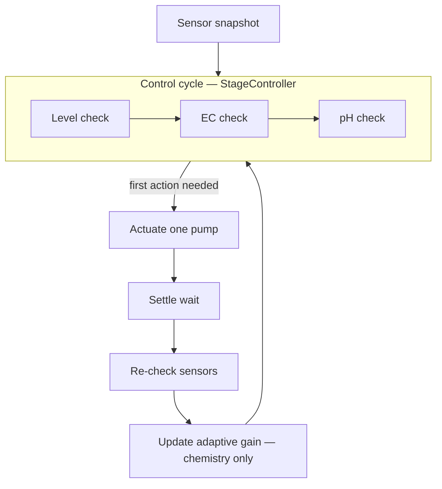

# Chemistry and reservoir control system

**Smart hydroponic garden — firmware control specification**  
**Status:** DWC with air stone; live law = `adaptive_P` (firmware 1.9)  
**Audience:** scientific write-up, calibration, and field debugging

This document describes the **control system currently implemented in firmware**.
It is the authoritative reference for pH, EC (nutrient), and scheduled water
top-up behaviour. For the first-prototype post-mortem (Kratky failure, pump
calibration wizard, and retired `ControlLaw` framework), see
[CONTROL_REPORT.md](CONTROL_REPORT.md).

**Source of truth in code:** `shared/stage_controller.h` orchestrates the
cycle; chemistry laws live in `shared/ph_control_loop.h` and
`shared/ec_control_loop.h`; design constants are in `shared/control_design.h`;
per-stage setpoints are in `shared/grow_stage.h`.

---

## 1. System overview

The reservoir runs as **deep water culture (DWC)** with an air stone for
oxygen and bulk mixing. Control is **discrete-time and event-driven**: the
firmware measures sensors, decides whether a dose or top-up is needed, actuates
one pump at a time, waits a **settle interval** for mixing and probe lag, then
re-measures and (for chemistry) **updates adaptive gains**.

| Loop | Sensor | Actuator | Control law |
| --- | --- | --- | --- |
| Water level (drawdown) | Grove I2C level pads | Fresh-water pump GPIO 18 | Scheduled drawdown maintenance |
| EC / nutrients | Grove TDS (ppm) | Nutrient pump GPIO 19 | Adaptive proportional + dead band |
| pH | SEN0169 (GPIO 32) | pH-up GPIO 23 / pH-down GPIO 5 | Adaptive proportional + dead band |

Telemetry identifies the chemistry law as **`control_law: "adaptive_P"`**
(MQTT / Influx). Adaptive gains are published as `gain_ph_up`, `gain_ph_down`,
and `gain_ec`.

Pump actuators are **mutually exclusive** — only one chemistry or water pump
runs at a time. While a dose or settle wait is in progress, no new control
decision is taken.

---

## 2. First prototype: why bang-bang was retired

The first build used a **threshold (bang-bang)** controller on a passive
**Kratky** reservoir (no air stone, no circulation):

- If pH was outside the band → run a **fixed-duration pulse** (initially ~2 s,
  later **one 500 ms burst** after calibration).
- Re-check on a **short timer** (~60 s) without waiting for mixing.
- After each pH pulse, firmware **chased with fresh water** — treated as mixing,
  but in a still tank it only added volume and did not homogenise the solution.

That combination failed for predictable physical reasons:

1. **Probe lag** — acid/base leaves the tube as a local plume; the bulk pH at
   the probe may not move for a long time. The controller interpreted “no change
   yet” as “need more chemical” and dosed repeatedly → **pH overdose**.
2. **No aeration** — still, warm nutrient water went anaerobic (foul smell,
   bacteria); a chemistry loop cannot fix dissolved oxygen.
3. **Fixed dose size** — a 0.15 pH miss received the same slug as a 0.6 miss.
4. **Uncalibrated pumps** — “2 seconds” or “500 ms” had no reliable mL meaning.

The hardware response was **DWC + air stone**. The software response was the
**staged controller** described below: proportional dose sizing, **wider dead
bands**, long **settle waits**, **no fresh-water chase after pH**, and
**online gain adaptation** from dose–response pairs.

The old `ControlLaw::THRESHOLD` / `ACTIVE_CONTROL_LAW` path and the
`controlPH()` / `controlNutrients()` decision loops are **compiled out**
(`#if 0` in `embedded-smart-garden.ino`). They remain in the tree for reference only.

---

## 3. Architecture



**Entry point:** `serviceStagedControl()` in `embedded-smart-garden.ino` calls
`StageController::planControlCycle()` on each sensor cycle (and when manually
triggered with Serial `CYCLE`).

**Cycle order (priority):**

1. **Level** — if drawdown is above target + tolerance, top up (only in
   `SEEDLING` … `HARVEST`).
2. **EC** — if enabled for the stage and TDS is below the dead-band low limit,
   dose nutrient.
3. **pH** — if enabled and pH is outside the dead band, dose acid or base.

Only **one** action is returned per cycle. If level needs water, EC and pH wait
until the refill is done (1.9.24): once the drawdown passes target + tolerance a
**refill** starts. Each top-up is sized from the water pump's calibration (the
remaining deficit) and runs at most 3 min (`TOPUP_CHUNK_MAX_MS`); the pump stops
early as soon as the live level reaches the target. Between chunks the pump rests
30 s (`TOPUP_REST_MS`) and the level is checked again, until it is back at the
target. Then nutrient waits until TDS stops moving after the dilution: |slope|
within the larger of 2 ppm/min and 0.5 % of the reading per min over 2 min, at
most 20 min (before 1.9.24 a fixed 20 min). A refill that has not reached the
target after 90 min (`TOPUP_REFILL_LIMIT_MS`) stops, logs `topup_time_limit`,
and hands over to nutrient and pH; the next refill waits for the next level
interval. Before 1.9.24 the water pump ran a fixed 1.5 s pulse (about 1 mL).

**Level loop details (1.9.24).** Level decisions use the median of the last 30 s
of stick readings (one every 2 s; the Grove stick reads in 5 % steps). A refill
starts once the smoothed drawdown has been past target + tolerance for 1 min and
stops once the smoothed level has been at the target for 10 s; there is no level
timer. On/off with hysteresis, the band one sensor step wide. If the readings
span two or more steps within a minute, or two steps' worth of water goes in
with no step change, the refill **holds** and waits for `REFILL PROCEED` (Serial)
or `{"cmd":"refill_proceed"}` (MQTT, dashboard button); nutrient and pH carry
on. The tank's mL per mm is learned from the volume between step crossings
(seed 121 mL/mm, `/level_ml_per_mm.txt`). `REFILL` prints the status.

**Pausing one loop.** `PAUSE LEVEL` / `RESUME LEVEL` (and `NUTRIENT`, `PH`) on
Serial, or `{"cmd":"loop_pause","loop":"level","paused":true}` over MQTT
(dashboard Settings), pauses that loop alone; the others keep running in order.
Pausing the level loop stops a running top-up at once. A paused nutrient loop no
longer holds pH back. Saved in `/loops_paused.txt`; `LOOPS` prints the state.
`AUTO PAUSE` still holds all of them. If the top-up is refused (water
pump offline, level sensor fault, low stock), EC and pH run on the next pass
without it, and the top-up is asked for again at the next level interval
(1.9.24). Before that, the refused top-up was asked for on every pass and EC and
pH never ran: on 16–18 Oct, with the water pump unplugged, nothing was dosed for
37 h. A refused pH dose (`PH_DOWN_PUMP_OFFLINE`, low stock) holds the limits
for `LIMIT_CYCLE_RETRY_MS` instead of planning the same dose on every pass.

**After EC settles**, firmware sets `runPhAfterEcSettle` so pH is checked on the
next cycle even if the pH interval has not elapsed (nutrient before pH). While
that flag is set EC is not checked, so a cycle is always **one nutrient dose →
mix (`ecSettleMs`) → pH check**, never a second nutrient dose ahead of pH. If
the nutrient dose is refused (bottle empty, low stock, `ENABLE_PUMPS=0`), the
pH check still runs on the next pass.

**Manual cycle** (Serial `CYCLE`, MQTT `{"cmd":"cycle"}`, dashboard **Run
control cycle** button) bypasses the interval timers for one pass of this
order: level → EC → pH. It still waits for any settle in progress, and does
nothing while auto control is held (`AUTO PAUSE`, FILL, CAL, soft-prime, or a
stage without auto control). Telemetry `sched.cycle_requested` is true until
the cycle is planned; `sched.ph_after_ec` is true while the pH check is owed.

**After any water top-up**, `chemistryAfterTopUpPending` forces an EC/pH
re-check when dilution or level change may have shifted chemistry.

---

## 4. Shared mathematics (`shared/proportional_dose.h`, `shared/control_design.h`)

All chemistry dose sizing uses the same primitives. Every design constant
lives in `shared/control_design.h` (one per report symbol); per-stage values
(bands, dead limits, gain seeds, dose limits, settle waits) live in
`shared/grow_stage.h`. The report's table *Report constants and their
implementation* maps each symbol to its line here.

### 4.1 Bands and dead limits

Each loop has a setpoint, a target band and dead limits:

| Region | Condition | Action |
| --- | --- | --- |
| **Target band** | `targetMin ≤ reading ≤ targetMax` | No dose (`in_band`) |
| **Inside dead limits** | `deadLow ≤ reading ≤ deadHigh`, outside target | No dose (`dead_zone`) |
| **Low** | `reading < deadLow` | Dose to raise (pH-up or nutrient) |
| **High (pH only)** | `reading > deadHigh` | Dose to lower (pH-down) |
| **High (EC)** | `reading > deadHigh` | **No nutrient dose** (`ec_high_no_dilute`) |

The pH dead limits are the plants' **tolerance range**, not their optimum:
basil + lettuce resolve to setpoint 6.0 with dead limits 5.5–6.5. Plants move
pH themselves as they feed, so pH is only corrected when it leaves the range
they grow normally in. The dashboard plant catalogue sends the setpoint and
dead limits explicitly (`ph_setpoint`, `ph_dead_low/high`, `ec_dead_low/high`);
without them the firmware uses setpoint ± 0.5 pH and target ± 50 ppm. A
zero-width pH target (e.g. 6.0–6.0) is treated as a setpoint and the target
band is widened to ± 0.2 so `in_band` has a meaning.

### 4.2 Proportional dose (process-gain form)

The gain is a **process gain estimate** `K_hat`: the change in the reading
per mL dosed (ppm/mL for EC, pH/mL for pH). The dose divides the error by it:

```
dose_ml = clamp(LAMBDA × |error| / K_hat,
                minDoseMl,
                min(u_cap, hardMaxDoseMl))
u_cap   = |dead-range middle − reading| / K_label
```

- `LAMBDA` = 0.8: each dose aims to correct 80 % of the error.
- `u_cap` is the volume the reagent labels say the remaining error needs, for
  a fixed assumed volume `V_ASSUMED_L` = 6.5 L, so a wrong gain estimate cannot
  dose more than that. pH: `PH_GAIN_LABEL` = 1.54 pH/mL (10 mL / 100 L per pH
  unit at 6.5 L). Nutrient: `EC_GAIN_LABEL` = 14 ppm/mL, the gain identified
  from the 30 Sep run (455 ppm for a full-strength dose); a dose only crosses the
  opposite dead limit if the true gain exceeds 28 ppm/mL. Replace 6.5 L with the
measured volume once the level sensor can be trusted for it.
- `hardMaxDoseMl` is an absolute fail-safe from the labels: 32.5 mL nutrient
  (one full-strength tank dose), 1.0 mL pH (one label pH unit).
- The planned dose never exceeds what is left of the session cap.

**pH error:** `|pH − phCenter|` (`phCenter` is the setpoint).
**EC error:** `|ecTargetMid − ecPpm|` with `ecTargetMid` the target-band midpoint.

### 4.3 Online gain adaptation

After each dose the controller waits the settle time, re-reads the sensor and
updates the estimate from the **delivered** volume (calibrated rate × actual
run time, not the requested volume):

```
observed = Δreading / delivered_ml          (in the dosed direction only)
K_hat ← (1 − α) × K_hat + α × observed       (α = GAIN_ALPHA = 0.5)
K_hat bounded to [EC_GAIN_MIN, EC_GAIN_MAX] = [3, 60] ppm/mL
             or  [PH_GAIN_MIN, PH_GAIN_MAX] = [0.2, 6] pH/mL
```

- EC updates only when TDS rose by at least 5 ppm; pH only when it moved at
  least 0.05 in the dosed direction (drift the other way is not a response).
- Separate `gainUp` and `gainDown` for pH.
- Gains are re-seeded from the stage config on a stage change or reboot; a
  new set of setpoints from the dashboard does **not** reset them (they
  describe the tank, not the target).

Before firmware 1.9 the gain was stored in mL per unit of error but updated
with the observed change per mL (the reciprocal), so `gain_ec` grew from
0.0005 to over 100 and every nutrient dose sat at its 0.5 mL clamp. That is
fixed by holding the process gain and dividing by it.

This is **P-only** control with **no integral or derivative term**. Any
residual error inside the dead limits is accepted by design.

---

## 5. pH control (`shared/ph_control_loop.h`)

### 5.1 Input conditioning

pH is read as a 16-sample burst (median, drop samples > 0.25 pH from it,
mean of the rest), then a 2nd-order Butterworth low-pass at 2 mHz
(`shared/sensor_ema.h`; a 3 min EMA before firmware 1.9). The controller
acts on the average. Samples taken while a pump runs are skipped.
Invalid (`NaN`) pH → no action (`ph_invalid`).

### 5.2 Dose decision

| Result `reason` | Meaning |
| --- | --- |
| `ph_low` | Below `phDeadLow` → pH-up, dose from `gainUp` |
| `ph_high` | Above `phDeadHigh` → pH-down, dose from `gainDown` |
| `in_band` | Inside target band |
| `dead_zone` | Inside dead limits but outside target — intentional no-op |
| `session_cap` | Delivered session mL ≥ `phSessionCapMl` — stop auto pH |
| `ph_no_response` | Dose needed, but that direction's no-response fault is latched (§5.4) |
| `ph_invalid` | Bad reading |

### 5.3 PH_BASELINE (priming) mode

Same law; completion requires pH in the target band and stable for
`phBaselineRecheckMs` (30 min) without a dose, then `ready_to_seed`.

### 5.4 Session safety cap

`phSessionCapMl` limits the **delivered** acid + base volume per grow-stage
session (vegetative 10 mL). When hit, `sessionCapAlert` latches until a stage
change.

The session total is held in RAM, so a reboot or a firmware flash starts a new
session. The no-response fault below is saved to LittleFS and survives both.

**No-response fault.** After each settled pH dose the recheck compares the
change with what the tuned gain predicted. A dose expected to move pH by at
least `PH_NO_RESPONSE_MIN_EXPECTED` (0.15) that moved it by less than
`PH_MIN_DELTA` (0.05) the right way is *unanswered*; a dose that does move pH
resets the count. `PH_NO_RESPONSE_DOSES` (3) unanswered doses in a row in one
direction latch `noResponseFaultUp` / `noResponseFaultDown`: that direction is
not dosed again (`ph_no_response`), the other still is. The firmware logs a
`ph_no_response` event (`ph_dose_ml` = mL delivered in the streak), publishes
`ph_up_no_response` / `ph_down_no_response` in telemetry and the alerts list,
and marks `health.ph_up_pump` / `ph_down_pump` as a fault. Usual cause: the
pump is not turning or its line is not primed / not delivering; a tank far
more buffered than the tuned gain is the unlikely alternative. Clear it, after
checking with `PRIME PH_DOWN` (or `PH_UP`), with Serial `SESSION RESET PH` or
MQTT `{"cmd":"session_reset","loop":"ph"}` (dashboard Settings). 11–12 Oct
2026: 31 pH-down doses (23 mL) were logged with no change before this existed.

### 5.5 Gain

`PH_UP_GAIN_PHL_PER_ML` = 14.8 and `PH_DOWN_GAIN_PHL_PER_ML` = 12.1 pH L/mL,
divided by the volume (2.28 and 1.87 pH/mL at 6.5 L): the largest responses
measured (section 5.6, Gains). pH-up 14.8 is the one clean step near plain water
(+1.22 pH from 0.538 mL at 170 ppm, 1 Oct), above the Manutec label rate (10 mL
per 100 L per pH unit, 1.54 pH/mL at 6.5 L), which stays the dose limit.

### 5.6 Settle and timing

After a dose the recheck runs as soon as the filtered reading has settled
(1.9.22): first look `SETTLE_MIN_MS` (5 min, one slope window) after the dose,
then every `SETTLE_POLL_MS` (1 min) until the 5 min slope is under
`PH_SETTLED_PER_MIN` (0.006 pH/min) or `EC_SETTLED_PPM_PER_MIN` (2 ppm/min).
`phSettleMs` / `ecSettleMs` (20 min) are the nominal waits; past them the wait
extends in 5 min steps up to +20 min while the reading still moves. 14 Oct:
nutrient reached 90 % of its change in 1.4-1.7 min and pH-down in under 1 min,
but every recheck waited 20-40 min; a carbonate rebound after pH-down (~0.02
pH/min for 30 min) and the slow pH-up response (19 min) keep the slope test
waiting. Before 1.9.22 a pH wait that found the pH drifting before its nominal
end computed the extra time unsigned and checked at once. **No fresh-water
chase** follows a pH dose.

**Gains (1.9.22).** Doses are sized from fixed per-litre gains: the largest
response measured over every logged dose (`docs/dose_response/`,
`gain_identification.png`, faults excluded): pH-up 14.8 pH L/mL (1 Oct, clean
step near plain water), pH-down 12.1 (14 Oct), nutrient 262 ppm L/mL (6 Oct run
1). With u = λ|e|/K on an integrating tank the next error is e(1 − λK_true/K),
so no dose overshoots while K_true ≤ K/λ; a more buffered tank lands short and
the next check doses again. Until 1.9.22 pH-up used 2.52 pH L/mL × 700/TDS from
the 7 Oct citrate-buffered tank; on 14 Oct it read 0.40 pH/mL where the fresh
tank gave 1.25, and its 3 mL dose took pH from 4.36 to 8.1 (now 0.58 mL to
~5.1, then two smaller doses into the band). The dose limit stays the bottle rate's
volume to the setpoint (pH) and the learned 262 ppm L/mL (nutrient).

---

## 6. EC / nutrient control (`shared/ec_control_loop.h`)

### 6.1 When EC control runs

`ecControlEnabled` is true for `TRANSITIONAL`, `VEGETATIVE` and `HARVEST`.

### 6.2 Dose decision

| Result `reason` | Meaning |
| --- | --- |
| `ec_low` | Below `ecDeadLow` → nutrient dose from `gainEc` |
| `ec_high_no_dilute` | Above `ecDeadHigh` → **no pump action** |
| `in_band` / `dead_zone` | Same semantics as pH |
| `session_cap` | Delivered session mL ≥ `EC_SESSION_CAP_ML` (100 mL) |
| `ec_no_response` | TDS low, but the nutrient no-response fault is latched (below) |
| `ec_disabled` / `ec_invalid` | Stage off or bad reading |

**Nutrient no-response fault (1.9.22).** A settled nutrient dose whose TDS
rise is under `EC_NO_RESPONSE_FRACTION` (25 %) of what the tuned gain predicts
is unanswered (doses predicted under 30 ppm are not judged); a dose that does
raise TDS resets the count. `EC_NO_RESPONSE_DOSES` (3) in a row latch
`noResponseFault`: no more nutrient doses, the pH check runs next, a
`ec_no_response` event is logged, telemetry `nutrient_no_response` and alert
`nutrient_no_response` are published, and `health.nutrient_pump` is a fault.
Saved in `/ec_no_response.txt`; cleared by `SESSION RESET EC` / `ALL` or MQTT
`{"cmd":"session_reset","loop":"ec"}` after `PRIME NUTRIENT` shows the line
delivers. 14 Oct: after one partial dose, eight more (87 mL logged) moved TDS
by 7 ppm until the session cap; the fault would have stopped it after the third.

### 6.3 Gain seed and settle

`EC_GAIN_SEED_PPM_PER_ML` = 14 ppm/mL (30 Sep – 5 Oct bring-up, 6.5 L).
After a nutrient dose `ecSettleMs` (6 min) applies; when it completes the
TDS gain is updated. The nutrient also lowers pH, and the pH reading takes
`phSettleMs` (12 min) to show it, so the pH check is held until 12 min after
the nutrient dose (`WAIT_EC_PH_MIX`, telemetry `wait_ph_after_nutrient`).

---

## 7. Water level control (`shared/level_control_loop.h`)

This loop **only adds water**; there is no reverse drain in the staged path.

```
drawdown_mm = (fill_0_percent − current_level_percent) × GROVE_MM_PER_PERCENT
```

When `drawdown_mm > targetDepthMm + toleranceMm`:

```
top_up_ml = (drawdown_mm − targetDepthMm) × ml_per_mm   (minimum 1 mL)
```

The tank is refilled only to the stage air-gap target below the net pots (vegetative 20 mm,
harvest 30 mm). After a top-up: **6 min** settle (`WATER_SETTLE_MS`, the TDS mixing time), then a
chemistry re-check. The level is also checked at the start of every chemistry
re-check, so volume is always restored before a dose is sized.

---

## 7a. Nutrient solution monitor (`shared/solution_monitor.h`, `solution.cpp`)

The loops hold pH and TDS in band but not the solution's composition: plants
take up N, P and K faster than Ca, Mg and S, so EC-based top-up lets the slow
ions build up, and every pH correction adds counter-ions and buffer. Instead of
a fixed renewal interval, six indicators, each graded `watch` / `due`, say when
and why the water should be changed. Advisory only: nothing is dosed or blocked.

| Indicator | Watch / due | Mechanism |
| --- | --- | --- |
| `age` | 21 / 28 days | Calendar fallback (4-week renewal in the literature) |
| `turnover` | 1 / 2 tank volumes of auto top-up | Ions not taken up concentrate |
| `reagent` | 0.75 / 1.5 mL/L of pH reagent that moved pH | Added salt and buffer |
| `buffer` | settled change ≤ 60 / 35 % of the tuned-gain prediction (≥ 3 doses, filtered) | Tank more buffered than the model |
| `ph_band` | 6 / 12 of the last 24 h outside the dead limits (+0.1) | Solution no longer holds pH, by auto or hand dosing |
| `tds_high` | 12 / 24 h above `ec_dead_high` | The firmware never dilutes |

Doses that did not move pH are left to the no-response fault (section 5.4).
A water change resets everything: a confirmed refill (`CONFIRM`), plain water in
the tank (TDS < 50 ppm), Serial `WATER CHANGED` or MQTT `{"cmd":"water_changed"}`.
Age, top-up, reagent and the dose-response filter are saved in `/solution.txt`;
the 24 h pH and TDS windows are RAM only. Telemetry `solution` object (`status`,
`due`, `watch`, `age_d`, `turnover`, `reagent_ml_per_l`, `buffer_ratio`,
`buffer_n`, `ph_out_h`, `tds_high_h`); alerts `water_change_due` /
`water_change_soon`; a `water_change_due` control event when it becomes due.
Serial `SOLUTION` prints the indicators.

## 8. Actuation and calibration

Chemistry pumps are calibrated as mL per 500 ms burst and run **continuously**
for `dose_ml / ml_per_burst × 500 ms`. The volume booked against the
controller (gain update, session caps, TDS salt observer) is the delivered
volume from the measured run time. Per-dose run ceilings
(`CAL_MAX_DOSE_BURSTS_*`: nutrient 85 bursts ≈ 34 mL, pH 5 bursts ≈ 1.5 mL)
sit just above the controller's hard maxima and only stop a runaway.

Each chemistry dose is stopped by an `esp_timer` one-shot at exactly its run
time (`armDoseStopTimer`, `staged_control.cpp`); the loop only books the dose,
and stops the pump itself only if the timer is more than 250 ms late. The
sensor cycle is a non-blocking state machine (`sensor_acq.cpp`): one short
step per loop pass, waits by `millis()`, and the pH/TDS bursts wait while a
pump draws on the shared 5 V rail. Sensor reads and pump runs therefore never
lengthen or corrupt each other.

If a pump is not calibrated, firmware falls back to one 500 ms pulse and
warns — proportional sizing requires `CAL PH_UP`, `CAL PH_DOWN` and
`CAL NUTRIENT`.

---

## 9. Grow-stage parameters

Setpoints and timing are in `GrowStage::STAGE_CONFIGS`
(`shared/grow_stage.h`). Switch stages with Serial `MODE …` or the dashboard.

| Stage | Drawdown | pH setpoint (dead limits) | EC target (dead) ppm | Level | pH | EC |
| --- | --- | --- | --- | --- | --- | --- |
| `IDLE` | — | display only | — | — | — | — |
| `FILLING` | — | 6.0 (5.5–6.5) | — | — | — | — |
| `PH_BASELINE` | — | 6.0 (5.5–6.5) | — | — | ✓ | — |
| `SEEDLING` | 0 mm ±10 | 6.0 (5.5–6.5) | — | ✓ | ✓ | — |
| `TRANSITIONAL` | 20 mm ±5 | 6.0 (5.5–6.5) | ½ × vegetative | ✓ | ✓ | ✓ |
| `VEGETATIVE` | 20 mm ±5 | 6.0 (5.5–6.5) | 600–800 (550–850) | ✓ | ✓ | ✓ |
| `HARVEST` | 30 mm ±5 | 6.0 (5.5–6.5) | 0–200 (0–250) | ✓ | ✓ | ✓ |
| `SENSOR_BASELINE` | — | display only | — | — | — | — |

Vegetative pH and EC are the defaults until the dashboard plant catalogue
applies the plants' values (persisted in `/veg_setpoints.txt`).

### 9.1 Vegetative controller parameters

| Field | pH loop | Nutrient loop |
| --- | --- | --- |
| Setpoint | 6.0 | 700 ppm (band midpoint) |
| Target band | 5.8–6.2 | 600–800 ppm |
| Dead limits | 5.5–6.5 | 550–850 ppm |
| `LAMBDA` | 0.8 | 0.8 |
| Gain `K` (per litre) | up 14.8, down 12.1 pH L/mL (largest measured) | 262 ppm L/mL (largest measured) |
| Per-dose limit | bottle-rate volume to the setpoint (1.54 pH/mL at 6.5 L) | volume to 700 (800 within 200 ppm) at 262 ppm L/mL |
| Min / hard max dose | 0.05 / 3.0 mL | 0.1 / 25 mL |
| Settle wait | 5 min minimum, until settled; max 20 min | same |
| Cycle start | reading outside its dead limits, or manual CYCLE | same |
| Session cap (delivered) | 10 mL | 100 mL |

### 9.2 Timing

There is no timer for the chemistry loops (1.9.23). A cycle starts as soon as
the filtered TDS falls below its dose limit or the filtered pH leaves its dead
limits, or on a manual CYCLE, and runs level → nutrient → pH. The only waits are
the settle waits: after a dose the recheck comes as soon as the reading stops
moving (from 5 min), at the latest 20 min after the dose.

The two feedback loops are sequenced. The nutrient loop runs to completion
first: it doses and rechecks until the TDS is at or above its dose limit. pH is
dosed only once TDS control has finished with the TDS in range, because the
concentrate shifts pH. If a fault stops the nutrient loop (no-response fault,
session cap, refused dose, dry TDS probe), pH is corrected on its own to keep the
plants healthy until it is fixed. A cycle started by the limits that cannot dose
anything waits 20 min (`LIMIT_CYCLE_RETRY_MS`) before the limits start another.
The level has its own 30 min timer (`LEVEL_CHECK_MS`) and is also checked at the
start of every cycle.

The waits are the measured mixing time through the 2 mHz input filter
(`docs/filter_analysis/settle_times.py`): nutrient doses settle in 3.3 min
(90 % within 4.3 min), the one clean pH step in 9.0 min.

---

## 10. State machine and boot behaviour

| State | After | Duration |
| --- | --- | --- |
| `WAIT_WATER_SETTLE` | Top-up completes | 2 min |
| `WAIT_EC_SETTLE` | Nutrient dose completes | `ecSettleMs` (6 min) |
| `WAIT_PH_SETTLE` | pH dose completes | `phSettleMs` (12 min) |
| `WAIT_EC_PH_MIX` | TDS recheck after a nutrient dose | until `phSettleMs` after that dose |

**Boot hold:** no automatic action for `POST_BOOT_HOLD_MS` (10 min) after a
reboot while the sensor averages warm up; then every loop is checked straight
away. **Auto resume** (1.9.21+, `AUTO RESUME` / MQTT `auto_resume`) is a clean
start, the same as a boot: a pause can last through a water change or hand
doses, so every wait, pending recheck, half-finished dose record and the
nutrient "still mixing" skip are cleared (`armFreshStart`), the 10 min hold runs
while the averages settle on the new water, and then the full level → nutrient →
pH cycle decides from fresh readings. Before 1.9.21 a stale skip flag could make
the first nutrient check after resuming skip its dose. Plain water (TDS < 50 ppm)
is a fresh session, the same as `SESSION RESET ALL`: both session caps and the
pumps' no-response warnings clear, and `ph_session_reset` / `ec_session_reset`
are logged with `plain_water` (1.9.24; before, only the caps cleared). **Stage change:** checks run on the next pass
(no wait). Serial `CYCLE` / dashboard **Run control cycle** bypasses the holds.

---

## 11. Logging and telemetry

Every check and dose appends a row to `/control_events.csv` and may upload to
Influx (`control_event` measurement). Key fields:

| Field | Content |
| --- | --- |
| `event` | `level_check`, `ec_check`, `ph_check`, `ph_recheck`, `ec_recheck`, … |
| `ph_dose_ml` / `ec_dose_ml` | Requested dose volume |
| `ph_dose_dir` | `up` / `down` on recheck |
| `gain_up` / `gain_down` / `gain_ec` | Adaptive gains after update |
| `alert_flags` | e.g. `ph_session_cap`, `ec_session_cap` |

MQTT JSON mirrors `control_law`, gains, drawdown, and calibration flags for
dashboard use.

---

## 12. Operator commands

| Command | Effect |
| --- | --- |
| `MODE <stage>` | Change grow stage; reset chemistry session counters |
| `CYCLE` | Run one control cycle now (bypass interval timers): level → EC → pH |
| MQTT `{"cmd":"cycle"}` | Same as Serial `CYCLE` (dashboard **Run all now**) |
| `CYCLE LEVEL` / `NUTRIENT` / `PH` | Run one loop now (1.9.28). The level is still checked first, and pH still waits for TDS to be in range |
| MQTT `{"cmd":"cycle","loop":"ph"}` | Same as Serial `CYCLE PH` (dashboard **Run now** on a loop) |
| `AUTO PAUSE` / `AUTO RESUME` | Hold/resume auto dosing without changing stage |
| `DOSE <pump> <ml>` | Metered operator dose (`PH_UP`/`PH_DOWN`/`NUTRIENT`/`WATER`); requires calibration; refuses if uncalibrated |
| MQTT `{"cmd":"dose","pump":"ph_up","ml":0.15}` | Same as Serial `DOSE` |
| MQTT `{"cmd":"auto_pause"}` / `auto_resume` | Same as Serial `AUTO PAUSE` / `RESUME` |
| `CAL …` | Pump calibration wizard (required for proportional burst sizing) |
| `SOLUTION` / `WATER CHANGED` | Show the solution indicators / record a water change (section 7a) |
| MQTT `{"cmd":"water_changed"}` | Same as Serial `WATER CHANGED` (dashboard **Water changed**) |

---

## 13. Source file index

| File | Responsibility |
| --- | --- |
| `embedded-smart-garden.ino` | `serviceStagedControl()`, burst actuation, sensor loop |
| `shared/stage_controller.h` | Cycle orchestration, settle FSM, event log hooks |
| `shared/ph_control_loop.h` | pH law, filtering, gain update |
| `shared/ec_control_loop.h` | EC law, gain update |
| `shared/proportional_dose.h` | Dead zone, dose sizing, process-gain update |
| `shared/control_design.h` | Controller design constants (report symbols) |
| `shared/grow_stage.h` | Per-stage setpoints and intervals |
| `shared/level_control_loop.h` | Drawdown top-up sizing |
| `shared/pump_calibration.h` | mL/burst and mL/s rates, stock |
| `shared/control_event_log.h` | CSV schema for control events |
