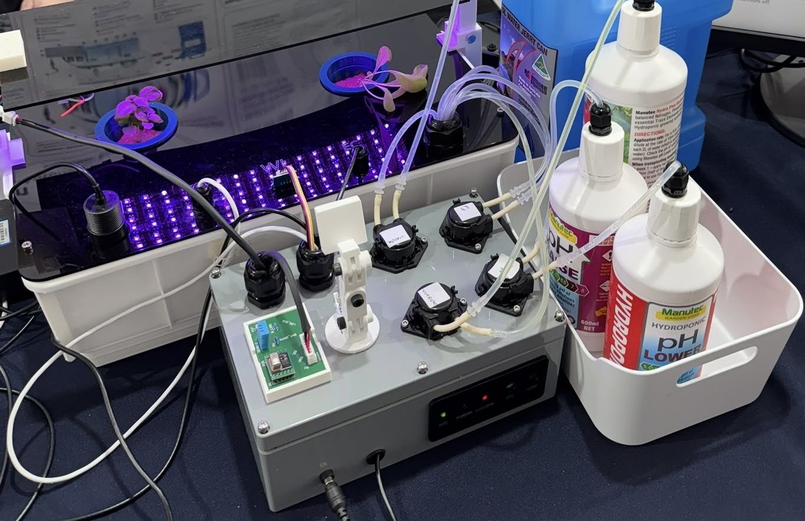
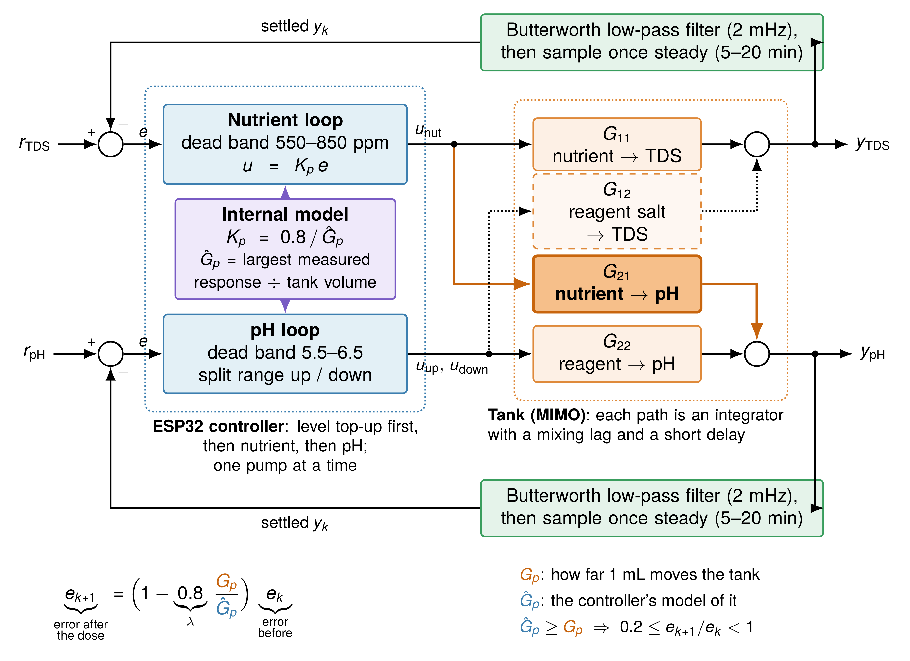
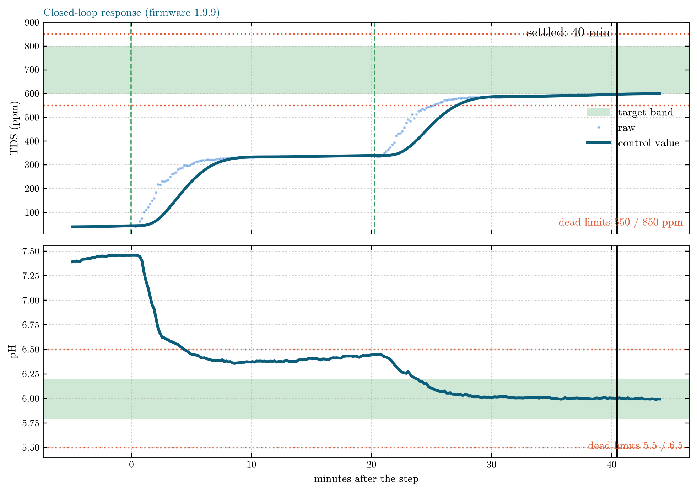
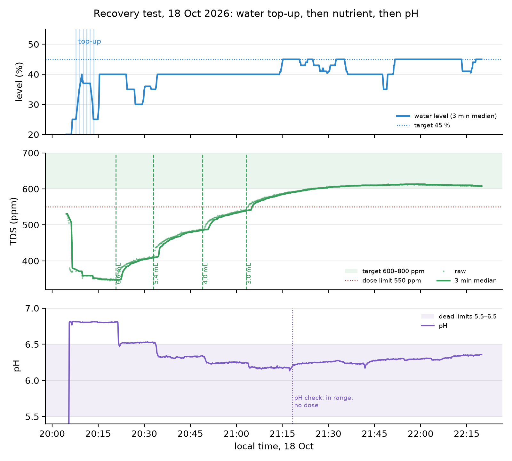
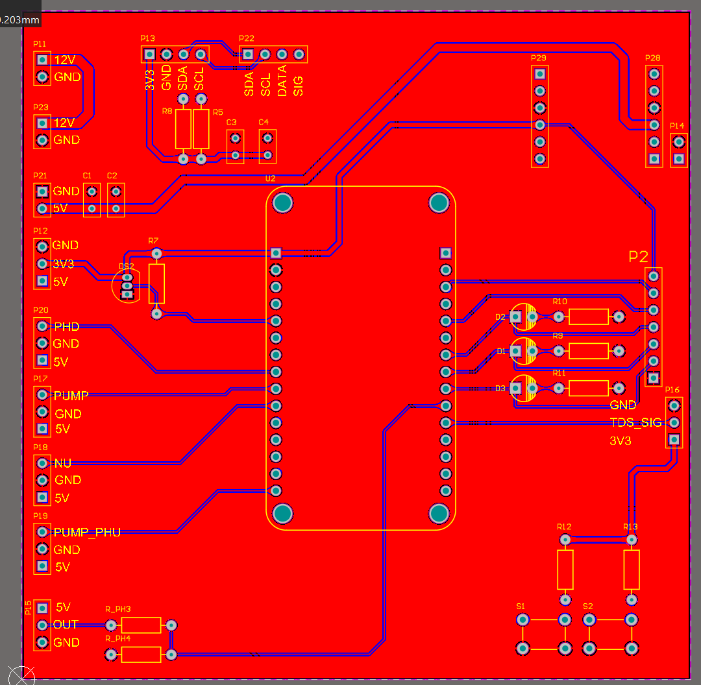
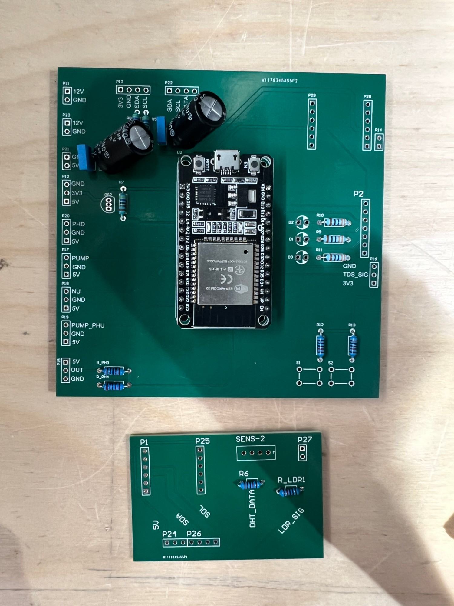

# Smart Hydroponic Garden: ESP32 firmware and control

[](https://github.com/s1j1k/embedded-smart-garden/actions/workflows/host-tests.yml)

Firmware for a closed-loop deep water culture (DWC) garden. An ESP32 on custom
PCBs measures the water and air every 10 s. It drives four dosing pumps and a
red/blue LED grow light, and keeps water level, nutrient strength (TDS) and pH
in range through each grow stage, with or without a network connection.
Telemetry goes to a Raspberry Pi and to InfluxDB Cloud.



*Capstone project: Intelligent Closed-Loop Hydroponic Garden System.* The
Raspberry Pi side (ingest, dashboard, alerts, plant vision) is in
[smart-garden-iot-dashboard](https://github.com/s1j1k/smart-garden-iot-dashboard).

## Highlights

- **Control of a slow, coupled process.** Each dose takes several minutes to
  mix in a tank stirred only by an air stone, and nutrient also lowers pH. The
  controller separates its loops in time: water first, then nutrient, then
  pH. Each loop gives a proportional dose sized from process gains identified
  in normal operation, then waits for the reading to settle before measuring
  again. With `Kp = 0.8 / Ĝp` and `Ĝp ≥ Gp`, each dose closes 20–100 % of the
  remaining error, so the loop approaches the target without overshoot even
  when the gain estimate is wrong.
  [CONTROL_SYSTEM.md](CONTROL_SYSTEM.md) has the full specification.
- **Failure analysis and redesign.** The first prototype used bang-bang control
  on an unmixed tank and overdosed pH, because probe lag looked like no
  response. [CONTROL_REPORT.md](CONTROL_REPORT.md) is the post-mortem. It
  compares threshold, P, PI and PID control, covers when feed-forward helps,
  and explains why part of the fix was physical (an air stone).
- **Modelling and system identification.** A nonlinear MIMO reservoir model
  (mass balances, charge-balance pH, mixing lag, dose delay) and its
  linearisation with RGA are in MATLAB/Simulink ([sim/](sim/README.md)).
  Process gains came from every settled dose on the real rig
  ([docs/dose_response](docs/dose_response)). The control input is filtered by
  a 2 mHz Butterworth chosen from a PSD of quiet-tank data
  ([docs/filter_analysis](docs/filter_analysis)).
- **Real-time firmware structure.** FreeRTOS tasks are pinned to cores.
  Sensing, control and pumps run on core 1 and never wait on the network.
  Wi-Fi/MQTT and an HTTPS uploader run on core 0. Bounded queues pass data
  between them, and LittleFS outboxes replay readings after outages: 99.5 % of
  numbered readings were stored and 2,740 were replayed, with none stored
  twice.
- **Safety interlocks.** Only one pump runs at a time, and no pH/TDS reading
  is taken while a pump loads the 5 V rail. Per-session dose caps stopped a
  faulty probe at 9.2 mL. Latched no-response faults stop dosing on a dry
  bottle or blocked line. Pump run times are ended by a hardware timer.
- **Tested off target.** The control logic in `shared/` is header-only C++ with
  no Arduino dependency. 94 host-side checks cover the dose law, gain update,
  dead bands and the filter step response, and run in CI on every push.



## Results

Closed-loop bring-up from plain water (firmware 1.9.9). Two nutrient doses
brought TDS into band in 40 min with no overshoot, and the nutrient alone
pulled pH from 7.46 to 6.01:



Recovery test with plants in the tank (18 Oct). After a water top-up diluted
the tank, four nutrient doses each smaller than the last (6.55 → 5.39 → 3.97 →
2.98 mL) brought it back inside its limits in 57 min with no overshoot. Full
settling took **71 min against a 60 min requirement**, slowed by a partly
blocked nutrient line ([run notes](docs/bringup_2026-10-18_full_cycle/README.md)):



| Test | Firmware | Result |
| --- | --- | --- |
| First unattended run, 30 Sep | 1.6.0 | Reached nutrient band in 57.5 h with small fixed doses every 2 h (the motivation for the redesign) |
| Bring-up runs 1–3, 6–7 Oct | 1.9.0–1.9.4 | Overshoot to 1045 / 889 ppm: the true gain was 2× the model, and one dose was sized from a part-mixed reading. Fixed by gain identification and settle detection |
| **Bring-up run 5, 7 Oct** | 1.9.9 | **Settled in 40 min, no overshoot** |
| pH step, 7 Oct | 1.9.12 | From pH 5.07 to inside limits in 38 min, no overshoot |
| **Recovery with plants, 18 Oct** | 1.9.24 | **Inside limits in 57 min, settled in 71 min, no overshoot** |

Every bring-up, calibration and characterisation run is in [docs/](docs) with
its raw CSV and plotting script, so each figure can be regenerated.

## Hardware

The design went from a validation breadboard to a soldered protoboard with
JST-XH harnesses, then to two custom PCBs designed in Altium: a Main board
(ESP32, pumps, water sensors, front panel) and an Ambient board (air sensors).
A 12 V, 60 W adapter feeds two 5 V buck converters, one for the controller
and pumps and one for the grow light alone, so the light's current never
flows through the controller's supply.

| Main PCB layout | Assembled Main and Ambient PCBs |
| --- | --- |
|  |  |

| Quantity | Part | Interface |
| --- | --- | --- |
| pH | DFRobot SEN0169 | ADC via divider; two-point buffer calibration; water-temperature compensated |
| TDS (EC) | DFRobot SEN0244 | ADC; AC excitation; temperature compensated |
| Water level | Grove capacitive level sensor | I²C; reads through the tank wall, 5 mm steps |
| Water temperature | DS18B20 | 1-Wire; also compensates pH and TDS |
| Air temperature, humidity | DHT11 | Digital (Ambient PCB) |
| CO₂ | Infineon XENSIV PAS CO₂ | I²C (Ambient PCB) |
| Light | LDR | ADC (relative only) |
| Actuators | 4 × DFRobot Gravity peristaltic pumps (water, nutrient, pH Up, pH Down) | Calibrated run time per dose |
| Grow light | WS2812B red/blue strip, staged photoperiod | FastLED, current-capped |
| Front panel | ON/OFF buttons, three status LEDs | GPIO |

Wiring, pin map, board iterations and the bring-up procedure are in
[BUILD_GUIDE.md](BUILD_GUIDE.md).

## Repository layout

```
embedded-smart-garden.ino   setup/loop, task start-up
*.cpp, garden.h             sensors, comms, MQTT, CSV journal, HMI, serial commands
shared/                     header-only control logic (loops, dose law, filters, calibration)
tests/host/                 off-target unit tests for shared/
sim/                        MATLAB/Simulink plant model and controller simulation
scripts/                    build/flash, serial logger, data export and plotting
docs/                       experiment logs, figures, design reviews
*_test/, water_fill_cal/    standalone bring-up sketches for each subsystem
```

## Build

**Host tests** (any C++17 compiler):

```sh
g++ -std=c++17 -I tests/host -I shared tests/host/control_logic_test.cpp -o control_logic_test
./control_logic_test
```

**Firmware** (arduino-cli with the ESP32 core; board options are in `sketch.yaml`):

```sh
cp secrets.h.example secrets.h   # Wi-Fi, MQTT and Influx settings, git-ignored
./scripts/compile.sh
arduino-cli upload -p <PORT> --fqbn "$(grep default_fqbn sketch.yaml | cut -d' ' -f2)" .
```

## Limitations and further work

- The water-level sensor's 5 mm steps limit the level loop: one refill
  stopped 5 mm short. A finer sensor is the main hardware recommendation.
- Air conditions are measured but not controlled.
- Next steps: Arduino compile and size check in CI; hardware-in-the-loop tests
  against the MATLAB plant model; MIMO control using the identified
  nutrient → pH coupling in place of time-staged SISO loops; a trial from seed
  to harvest across several networked tanks.

## License

MIT, see [LICENSE](LICENSE).
