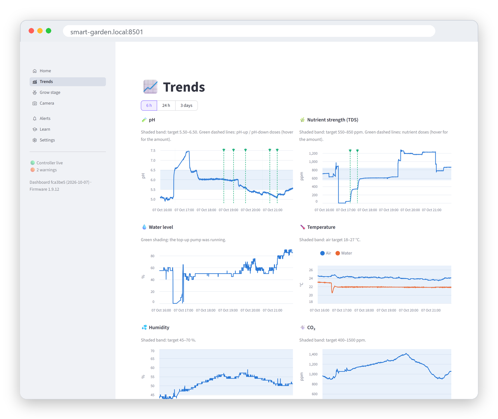
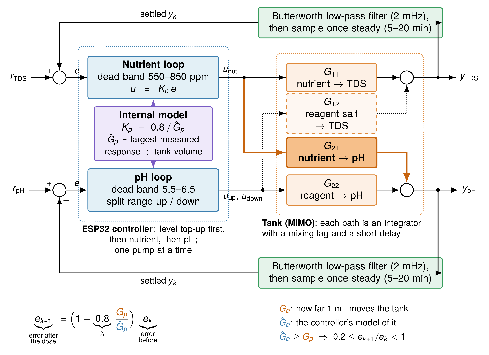
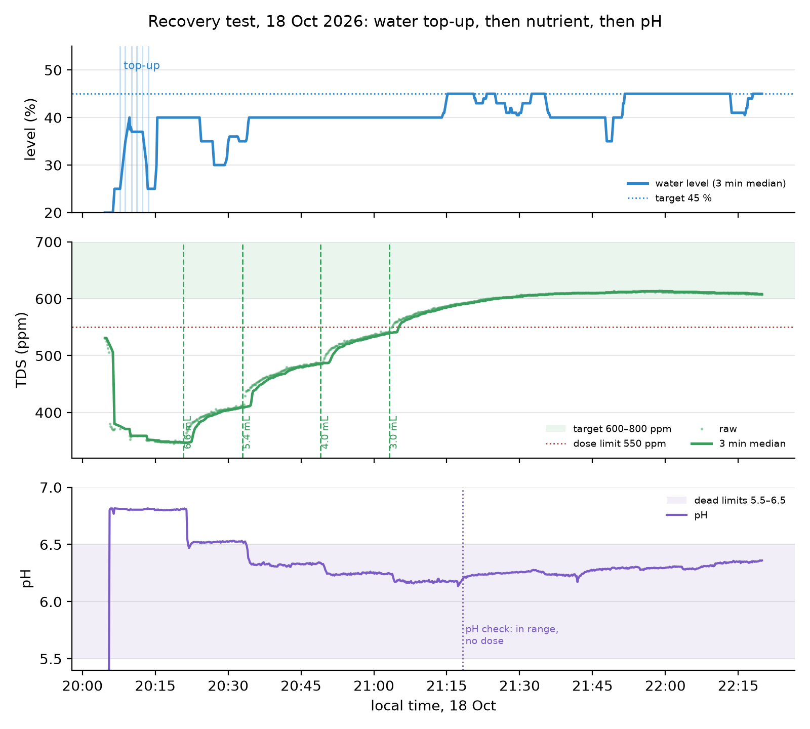
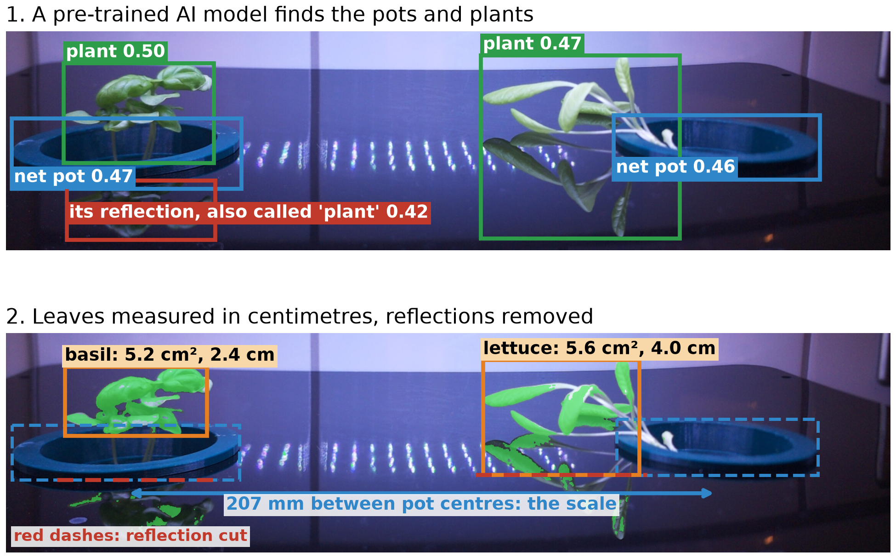
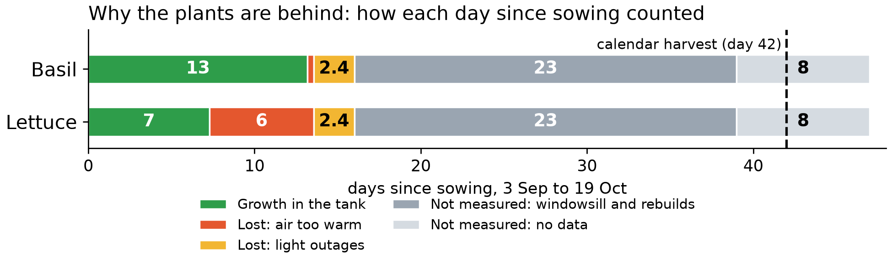
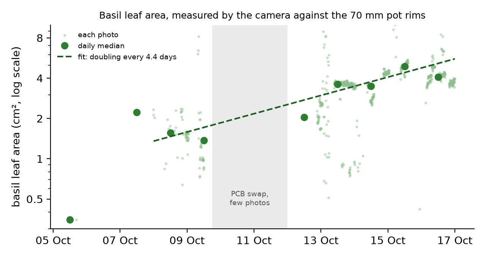

# Smart Garden poster: final text, layout and figures

Everything the poster should say, panel by panel, in the order a reader meets
it. Text in quote blocks is the wording to paste into Canva. Under each panel:
what figure goes there, and what to remove from the current poster. Sources and
longer notes for questions at the stand are at the end.

**Tone:** plain statements, one idea per bullet, numbers where we have them.
**Bold** marks the fact a reader should catch when scanning from 1 m.

**Headings:** each has a short descriptive subtitle after the colon (what the
panel covers, not a slogan). They help visitors find their way; drop any that
crowd the heading line.

**What a visitor should take away:**
1. Most home smart gardens run the light and pump on timers and leave the water
   chemistry to the user. This one measures the water and corrects it itself,
   including the pH drift that continues for hours after nutrient is added.
2. In most systems the user switches the growth stage by hand, and the stage
   sets the targets. This one predicts when each stage is due from the
   conditions the plants have had, and suggests the change.
3. The controller is deliberately cautious: its gains come from measured
   responses of the real tank, so each dose falls short of the target and the
   next one finishes the job.
4. A camera measures each plant, checks its health and forecasts the harvest.
   The photos, sensor readings and doses are stored together, a dataset for
   training and comparing other vision and AI methods.

---

## 1. Layout and print

**Size:** A0 landscape (1189 × 841 mm), read from about 1 m.

| Element | Size |
|---|---|
| Title | 100–120 pt |
| Subtitle | 60–72 pt |
| Panel headings | 48–60 pt |
| Body text | 24–28 pt, never under 20 pt |
| Captions, axis labels | 18–20 pt |
| Key-result numbers | 80–100 pt |

About 650 words in total, 70–110 per panel. Margins 25 mm, 15 mm between
panels, nothing touching the footer. Caption figures directly, with no
"Figure 1:".

**Grid:**

```
┌──────────────────────────────── Title band ──────────────────────────────────┐
│ Smart Garden / subtitle / names / supervisor       │ Key results: 3 tiles    │
├──────────────────┬───────────────────────────┬────────────────────────────────┤
│ Motivation       │ System Overview           │ Results: water control         │
│                  │ (cutaway diagram)         │ (full-cycle plot)              │
├──────────────────┤                           ├────────────────────────────────┤
│ Hardware and     ├───────────────────────────┤ Results: plants, camera and    │
│ Housing          │ Control System            │ data (growth curve +           │
│ (photo strip)    │ (block diagram)           │ timelapse strip)               │
├──────────────────┤                           │                                │
│ IoT Dashboard    │                           │                                │
│ (QR + 1 screen)  │                           │                                │
├──────────────────┴───────────────────────────┴────────────────────────────────┤
│ Footer (or move the project code into the title band)                         │
└───────────────────────────────────────────────────────────────────────────────┘
```

The left and middle columns say what was built and how it works; the right
column is all results: one box for the water control, one for everything else.

**Moves from the current poster:**
- **IoT Dashboard** goes to the bottom of the left column.
- **Results** becomes two boxes filling the right column: water control on
  top, then plants, camera and data (this replaces the Plant Vision panel).
- **System Overview** loses about 15 % of its height (smaller legend, less white
  space under the drawing), and **Control System** gets that space.

---

## 2. Title band

> **Smart Garden**
> Beyond Monitoring: Towards Autonomous Control

**Key results** (keep as they are on the current poster):

| Tile title | Big number | Line under it |
|---|---|---|
| Control | **2 doses, 12 min** | Plain water to the plants' nutrient range |
| Autonomy | **110 h** | Unattended, every reading and dose logged |
| Plant Vision | **2.6× leaf area** | Basil in 8 days, measured in cm² |

---

## 3. Motivation (left column, top)

**Heading:** Motivation: automating the water chemistry

> Hydroponics **uses less water** than soil, **grows plants faster** and is
> **clean indoors**. The plants feed from the water, so its **pH and nutrient
> strength** must stay in range, and both drift as the plants feed: a real
> control problem, which is why we chose it. **Most home smart gardens leave
> measuring and correcting the water, and changing the growth stage, to the
> user.** This garden **measures both every 10 s, doses nutrient, pH Up or
> pH Down itself, and predicts when the next stage is due.**
>
> **Why it is difficult in a 7 L tank:**
> - 1 mL of pH Up moves fresh water **2.2 pH units**, a buffered tank **0.05**
> - **Nutrient lowers pH**, which keeps drifting for hours
> - A dose takes **up to 20 min to mix**

**Remove:** the heading's subtitle "From monitoring to control" and the line
"Smart gardens tell you something is wrong. Ours fixes it." 

---

## 4. Hardware & Housing (left column, middle)

**Heading:** Hardware and Housing: a sealed, low-power unit

> The electronics moved from a breadboard to **custom circuit boards in a
> sealed box**, away from the water.
> - **Custom main and sensor circuit boards**, revised once after testing
> - **Laser-cut lid, project box and 3D-printed light stand**: the plants lift
>   out without unplugging anything
> - **Low power, 3 household plugs:** a 60 W, 5 V supply for the controller,
>   sensors, dosing pumps and LED light; an aquarium air pump for the air stone;
>   and the Raspberry Pi. Deep water culture needs no circulation pump.
> - **Low-power light:** red and blue LEDs, the colours leaves absorb most. A
>   **long 16 h day** and a stand that holds them **close to the plants** make
>   up for their low output.

**Figure:** the photo strip, 20 % smaller than now: breadboard → soldered →
PCB → project box. In the empty "Integration refinement" slot, add the photo of
the drilled project box with its status lights and buttons:

> Project box with status lights and buttons

**Remove:** "Built like a product" from the heading and the line "From
breadboard to a sealed, self-contained unit…". The housing photo can go if space
is short (the real unit is at the stand).

---

## 5. IoT Dashboard (left column, bottom)

**Heading:** IoT Dashboard: live data and alerts

> **Every 10 s** the controller sends its readings and doses over Wi-Fi to a
> **Raspberry Pi**, which stores them and serves this dashboard.
> - **Trend charts mark every dose**, so cause and effect are visible
> - **Alerts go to a phone**, even with the dashboard closed
> - **Raspberry Pi camera:** live view, a timelapse video and photo downloads,
>   so the plants can be watched remotely
> - **Scan the QR** to watch the garden live

**Under the QR code:**

> smartgarden.tech

**Figure:** one screenshot, the desktop trends page.



Spares, only if there is room: `phone_home.png`, `desktop_home.png`,
`desktop_stage.png`, `phone_trends.png`, `phone_growlight.png`.

**Remove:** "Watch the garden think, from anywhere.", the line about several
people watching at once, and the second screenshot.

---

## 6. System Overview (middle column, top)

**Heading:** System Overview: what each part does

> An **ESP32 microcontroller** at the tank reads the sensors, runs the dosing
> pumps and the light, and **keeps controlling the water if the Wi-Fi drops**. A
> **Raspberry Pi** stores every reading, hosts the dashboard and alerts, and
> photographs the plants.

**Figure:** keep the labelled cutaway. Shrink the numbered legend to body-text
size or drop items already visible in the drawing; cut the white space under the
drawing.

---

## 7. Control System (middle column, bottom)

**Heading:** Control System: dosing a slow-mixing tank

> Decoupling the nutrient and pH loops gives faster, steadier control than
> letting them interact [1]. Published systems decouple them mathematically,
> in a solution that **mixes in seconds**. Ours is a **deep water culture tank
> mixed only by an air stone**, where a dose takes **up to 20 min** to reach the
> probe, so it **decouples them in time: it doses in steps, waits for each dose
> to mix, and corrects one thing at a time:**
> 1. **Water level** first: a top-up dilutes everything else.
> 2. **Nutrient** next: it lowers the pH (6.8 to 6.2 on 18 Oct).
> 3. **pH** last, once the nutrient has mixed.
>
> Each dose is sized from how this tank responded to earlier doses and **stops
> just short of the target**; a smaller second dose finishes the job.
>
> [1] Putri, Siswojo & Rusli (2026), *Kinetik* 11(2), 237–248.

**Figure:** `control_loops.png` (600 dpi; vector `control_loops.pdf`), at least
50 % larger than the current diagram so its labels can be read. It already
includes the dose equation, so remove the separate equation strip.



**Caption:**

> Two loops share one tank. The pH loop runs only after the nutrient has
> settled, because nutrient lowers pH.

**Remove:** "One loop at a time" from the heading, all four current bullets
(filtering, sequence, the u = Kₚe dose formula, target band), the whole "What
we learned" paragraph, "Figure 1:", and the separate equation image. The
filtering detail and the formula are in the stand notes.

---

## 8. Results: water control (right column, top)

**Heading:** Results: water control

> - **Plain water (16 Oct):** into the nutrient range in **12 min, 2 doses**.
> - **Recovery after a pause (18 Oct):** back inside its limits in **57 min
>   with no overshoot**, in four shrinking doses; pH came into range without a
>   dose.
> - Doses are sized for fresh water, the strongest response, so in an older
>   tank they fall short and take more steps: **slower, but no overshoot to
>   stress the plants**.

**Figure:** the full-cycle plot, as large as the box allows.

> Recovery test with the plants in: water top-up, then nutrient, then the pH
> check. Dashed lines are nutrient doses.



**Remove:** the two old plots (16 Oct nutrient, 7 Oct pH) and the 38 min,
5–20 min and 57.5 h → 12 min bullets (all in the stand notes).

---

## 9. Results: plants, camera and data (right column, below)

**Heading:** Results: plants, camera and data

> A camera photographs the plants **every 5 min** under its own white flash.
> - **Finding and measuring:** a **pre-trained AI model** finds the pots and
>   plants with no training on this garden; leaves are measured in cm against
>   the 70 mm pot rims, with lid reflections removed. The scale was found in
>   **91 % of 1,427 photos**.
> - **Growth:** basil leaf area **grew 2.6× in 8 days**, doubling every 4.4
>   days; lettuce about 1.7×.
> - **Plant health:** image processing measures each plant in every photo,
>   and rules compare it with its own last 3 days. **Stretch = height ÷ √leaf
>   area**; above **2.8** is leggy. On 13 Oct the lettuce scored **3.3**, basil
>   **1.7**, with the air at **28 °C** listed as a likely cause.
> - **Data:** **650,000 readings** and 1,427 photos since 30 Sep, each photo
>   aligned with the readings and doses at that moment.
> - **Random forests (being tested):** a random forest is many small decision
>   trees that vote. Ours **fuse camera and sensor data**: leaf area and growth
>   with temperature, light hours and water and nutrient use, to predict the
>   **growth stage and harvest date**. Most gardens make the user change the
>   stage by hand; this is the step towards automating it. On the first 10 clean
>   days, it ranked **nutrient in range** and **plant size** as the biggest
>   influences on daily growth; a reliable harvest date needs more days.
> - **Why the plants are behind the calendar** (figure): each measured day is
>   scored by how well its temperature and light suited the crop. Lettuce lost
>   6 of 16 days to warm air; 23 days were spent outside the tank.

**Figures** (in this order, top to bottom):

How the plants are found and measured (15 Oct photo, the last clean view):

> The AI model boxes the pots and plants (it also boxes the basil's reflection,
> which the next step removes). Leaves are then measured in centimetres.



Why the plants are behind:

> How each day since sowing counted. Lettuce lost 6 of its 16 measured days to
> warm air; 23 days were spent outside the tank.



Growth curve:

> Basil leaf area measured by the camera. It doubles about every 4.4 days.



Layout in the box: the detection figure full width under the intro line, then
the growth curve and the "why" bars side by side, then the bullets. Make each
figure as large as the box allows: their labels must read at 1 m. Leave out the
timelapse strip (`timelapse_strip.jpg`).

**Remove:** the Plant Vision heading and its method bullets (each result above
says how it was measured), the duplicated text over the old heading, and the
four old windowsill photos if any remain.

---

## 10. Footer

> EM-12-KBRI-037 | Electrical Engineering

---

## 11. Checklist: add, remove, move

**Add:**
- [ ] Project box photo (lights and buttons) in the "Integration refinement" slot
- [ ] `full_cycle.png` in Results
- [ ] `control_loops.png` in Control, larger than the current diagram
- [ ] `basil_leaf_area.png` and `timelapse_strip.jpg` in the second results box

**Remove:**
- [ ] Both Results plots (16 Oct, 7 Oct) and three of the Results bullets
- [ ] The long "What we learned" paragraph
- [ ] The separate dose-equation image under the Control figure
- [ ] Duplicated text in the Plant Vision panel
- [ ] Second dashboard screenshot
- [ ] Taglines and heading subtitles: "Ours fixes it", "From monitoring to
  control", "Built like a product", "From breadboard to a sealed…", "One loop at
  a time", "Watch the garden think"

**Move:**
- [ ] IoT Dashboard to the bottom of the left column
- [ ] Right column: two results boxes (water control; plants, camera and data)
- [ ] System Overview 15 % shorter; Control takes the space

---

## 12. Sources for the numbers

| Number | Source |
|---|---|
| Recovery test, 18 Oct | `docs/bringup_2026-10-18_full_cycle/`. Before the test the tank was at about 380 ppm (07:35 UTC, after a morning of doses through a partly blocked line); the 530 ppm at 20:04 is the filter starting up after a controller restart. Requirement C2 counts until both checks pass without a dose: 21:18, 71 min after the top-up, over the 60 min limit; the blocked line (a third of the usual response per mL) meant four doses instead of two. |
| Recovery test detail |  top-up 20:07–20:13, doses 6.55, 5.39, 3.97, 2.98 mL, TDS past the 550 ppm dose limit 44 min after the first dose and about 610 ppm settled; pH 6.81 → 6.19, checked at 21:18. pH probe calibrated in buffers that day. |
| 57 and 77 min | 18 Oct: first top-up burst 20:07; 3 min median TDS past 550 ppm at 21:05 and past 600 ppm at 21:24 (64 min after the first nutrient dose). |
| 650,000 readings | Pi SQLite, 30 Sep to 18 Oct: 648,540 sensor readings and 1.09 million MQTT messages. |
| 91 % of 1,427 photos | `scripts/assess_growth.py`, 19 Oct: 1,292 of 1,427 frames had a pot-rim scale. |
| 47 days, 16 measured, 7 and 13 | `trial_development_2026-10-19.csv` (from `scripts/trial_development.py` on the Pi's full record, breaks for the windowsill 3–25 Sep and the plain-water bring-ups 6–8 Oct); figure `why_growth.png` (`why_growth_figure.py`). |
| Detection figure | `plant_detection.png` (`plant_detection_figure.py`): 15 Oct 13:01 photo; detector run on the Pi (127 s): net pots 0.47 and 0.46, plants 0.50 and 0.47, the basil's reflection 0.42. |
| Random forest first result | Harvest regression on the clean window (8–16 Oct, 10 day-to-day pairs): importances nutrient in range 37 %, plant size 28 %, temperature fit 13 %, temperature 10 %, light hours 6 %. Its central projection is negative growth (the 15 → 16 Oct dip), so no date is claimed; the optimistic end of the trees gives 5 Nov (basil) and 29 Oct (lettuce). |
| A third as much per mL | 18 Oct: about 10 ppm/mL (345 → 408 ppm for 6.55 mL in 6.7 L); 16 Oct: 32 ppm/mL for the first dose in 7 L. Earlier on 18 Oct several doses had no effect at all, which points to the nutrient line. |
| 2 doses, 12 min | 16 Oct bring-up, `docs/bringup_2026-10-16_final/` (TDS; the pH probe was not buffer-calibrated that day). |
| 110 h | 30 Sep run: 40,341 readings over 119.6 h, 2.8 h of gaps, longest 24 min. Unattended, but with the first controller, whose control was poor. |
| 2.6× leaf area | Full-resolution photos re-measured on the Pi (`scripts/remeasure_plants.py`, `scripts/assess_growth.py`, 19 Oct). Basil daily medians 1.56 cm² (8 Oct) to 4.09 cm² (16 Oct), 30+ photos each day; fit 0.16 per day (95 % interval 0.11–0.21), doubling 4.4 days. Photos from 17 Oct on are excluded: the camera was moved and the basil's reflection cut fell on real leaves, and from 18 Oct the controller was offline, so the white flash did not fire. |
| 7 and 13 days of 16 | `scripts/trial_development.py` on the Pi's full record (30 Sep–18 Oct): lettuce 7.3 ideal days, 6.3 lost to air above 22 °C and 2.4 to light outages; basil 13.2. |
| 2.2 and 0.05 pH per mL | Report control appendix: 6.5 L of tap water, and the 7 Oct citrate-buffered tank. |
| 70 mm rim, 207 mm spacing | Net-pot and lid drawings, report appendices. |

---

## 13. Stand notes: for questions, not for the poster

**What commercial gardens do.** Most home hydroponic gardens run the light and
the water pump on timers; some measure and send alerts. Correcting pH and
nutrient is left to the user. Ours measures both and doses three reagents
itself, in sequence, with a model of how the tank responds.

**Other results.**
- 7 Oct: two pH Up doses took pH from 5.07 back inside 5.5–6.5 in 38 min with no
  overshoot (earlier firmware 1.9.12; its gains were later replaced).
- After each dose the controller waits until the reading has settled: at least
  5 and at most 20 min.
- The first controller took 57.5 h to reach the nutrient range: each dose was
  capped at 0.5 mL and checked every 2 h. The final one sizes each dose from a
  tank model.

**Why fixed, measured gains.** How far 1 mL moves the tank varies widely: from
2.2 to 0.05 pH units per mL of pH Up as the water becomes buffered, and a reading
taken before a dose has fully mixed shows only part of its effect. A gain set
at the largest response measured over the trial guarantees each dose stops
short of the target, whatever state the tank is in.

**How the gains were set.** Every dose is logged with the reading before it and
the settled reading after it, so the tank's response per mL was measured from
the trial itself (system identification). The controller uses the largest
response seen, so a dose can only fall short: on 18 Oct the nutrient line was
partly blocked and the loop still reached the range, in four smaller doses, with
no overshoot. The cost is speed when the tank responds weakly.

**Dataset.** Each timelapse photo is stored with its time, the plant
measurements in cm, the sensor readings and the doses around it, and the
growth stage the controller was on. That is labelled data for training or
comparing other vision models (for example a fine-tuned detector or a
segmentation network) against the current one. A second garden would double the
data at no extra effort.

**How the strategy was chosen.** The usual design steps for a coupled tank are:
define the inputs and outputs, identify how each input moves each output
(system identification), measure the coupling (relative gain array), then pick
the controller: separate loops if the coupling is weak, a multivariable (MIMO)
controller such as model predictive control if it is strong. We identified the
tank's response from every logged dose; the relative gain of the nutrient–TDS
pairing is 0.74–0.98 (above 0.5: weak, and one way, from nutrient to pH), so
separate loops are sound. Putri et al. (2026, Kinetik 11(2)) reached the same
conclusion in hardware and removed the interaction with a decoupling matrix,
settling pH in 11 s and TDS in 36 s, which needs a fast-mixing solution. Our
tank takes 5–20 min to mix, so we decouple in time instead: one loop at a time,
each acting only on settled readings. Continuous controllers (PID, fuzzy, hybrid
PID-fuzzy; Rathedi et al. 2023, Int. J. Eng. Res. Africa 65, simulation only)
assume a sensor that sees each action quickly; with a long, variable delay and
pumps that can only add chemical, integral action would build up during each
wait and overshoot.

**Why this order (water, nutrient, pH).** Water first because a top-up dilutes
everything, so nutrient and pH must be measured after it; extension guidance is
to replenish water and keep monitoring the solution (Singh & Dunn 2017, OSU
HLA-6722, the source of our pH and EC targets). Nutrient before pH because the
coupling runs one way: in our tank nutrient lowered pH (6.8 → 6.2 on 18 Oct;
7.46 → 6.01 in the 7 Oct bring-up), while the pH reagents change TDS very
little. The report quantifies this with the relative gain of the nutrient–TDS
pairing, 0.74–0.98 (above 0.5, so two separate loops are sound and the coupling
only shifts each loop's starting point). Correcting pH before or during feeding
would mean correcting it twice. Extension and grower guides follow the same
practice: mix the fertiliser fully, set EC, then adjust pH in small steps and
re-test.

**Dose formula and filtering.** Dose = Kₚ × error, with Kₚ = 0.8 ÷ (tank response
per mL), the response set at the largest measured. Each reading averages 16
samples over 80 ms (cancelling mains hum), then a 2 mHz Butterworth low-pass
filter.

**Why proportional control is enough.** A dose shifts the tank permanently,
y(k+1) = y(k) + K·u(k), so the tank is itself an integrator. P control alone
gives zero steady-state error. Integral action would add windup and overshoot,
which a system that can only add (never remove) cannot undo. With Kₚ = 0.8/K̂
the error shrinks by (1 − Kₚ·K) each cycle: it converges for gain errors up to
2.5× and does not overshoot up to 1.25×.

**Settling.** The controller waits until the filtered reading changes by less
than 2 ppm/min (TDS) or 0.006 pH/min (pH).

**Water level.** The level loop runs first, but the level sensor reads in 5 mm
steps and jumps between readings, so top-ups are approximate. A pressure,
time-of-flight or load-cell sensor would fix this.

**pH reagent salts.** The pH reagents leave salts that read as nutrient on the
TDS probe; the firmware subtracts them so it does not under-feed.

**Probe interference.** With the probes 200 mm apart the TDS probe shifted the
pH reading by 0.04, within the probe's accuracy, so no isolation switch was
needed.

**Grow light.** WS2812B RGB LEDs, red and blue during the 16 h day, white for
each photo. It averaged 15.2 h a day on measured days; outages (8, 14, 16 and
18 Oct) cost about 2.4 days of growth. Leafy greens want a daily light integral
of about 12–17 mol/m², about 210–295 µmol/m²/s at the leaves over 16 h; the light
at the leaves has not been measured yet.

**Power.** A 60 W DC adapter feeds two 3 A, 5 V buck converters, one for the
ESP32, sensors and pumps and one for the grow light. The air pump and the
Raspberry Pi have their own plugs.

**Growth against benchmarks.** Crop studies use fresh and dry weight at harvest,
days to harvest, leaf area and the relative growth rate. Basil grew at 0.16 per
day from 8 to 16 Oct (doubling in 4.4 days), a normal rate for a young plant;
lettuce about 0.09 per day (a lower bound: its flat leaves are partly cut at the
rim line). Basil in deep
water culture is usually harvested 35–38 days from sowing; ours were sown on
3 Sep and are still seedlings, after a lost first batch, three weeks on a
windowsill and several rebuilds. Weighing each plant at harvest will allow a
direct comparison.

**Missing data.** Days with no readings, or with the plants out of the tank, are
not filled in. They are counted at the plants' typical rate for the central
date, and at zero and full growth for the latest and earliest dates.

**Camera AI.** Grounding DINO (open-vocabulary, Apache-2.0) finds the pots from a
text description every 3 hours; between runs the pot positions are reused, as a
self-driving car reuses its map. Leaves are separated from the purple light on
the green–magenta axis of CIE L\*a\*b\*. Lid reflections are found by flipping
the image and matching edges.

**Plant health checks (rule-based, not machine learning).** Each plant is
compared with its own photos: "now" is the median of the last 4 hours, compared
with the same window 1 or 3 days earlier, with at least 3 photos in each.
- Leggy: stretch = box height ÷ √(leaf area) (unchanged by camera distance)
  above 2.8, or up 25 % in 3 days. 13 Oct: lettuce 3.3, basil 1.7.
- Curling: visible leaf area down 15 % in a day while height stays within 5 %.
- Paler: leaf colour moves away from green (CIE a* up 3 or b* up 4 in 3 days),
  compared only between photos under the same light.
- Stalled: leaf area grows less than 5 % in 3 days.
Each finding lists the live readings known to cause it, by rule: leggy always
lists weak light, plus warm air above 26 °C; curling lists hot or dry air, warm
water or high salts. These are observations, not diagnoses.

**Random forests.** The stage classifier learns from the stages the controller
actually ran, so no photos need hand labels; it does not see the plants' age,
pH or TDS, which the controller sets from the stage. The controller stayed in
the vegetative stage for the whole trial, so the classifier has only one stage
to learn from and cannot be scored yet. The harvest regression, trained on 16
day-to-day pairs, currently projects no harvest date: the photos after 16 Oct
(camera moved, then no flash) read as shrinking plants, so it needs more clean
days first. The harvest regression learns daily
leaf-area growth from that day's temperature, light hours and how long TDS and
pH stayed in range.

---

## 14. Challenges and failures: for conversation, not for the poster

What went wrong, what it caused, and what we changed. Useful when visitors ask
"what was hardest?" or "what would you do differently?".

**Plants**
- **First seedling batch lost.** The germination dome's opaque lid stayed sealed
  too long and the seedlings died of damping-off (a fungal rot that thrives in
  still, humid air). A clear, vented lid is the fix.
- **Late, small transplant.** The second batch spent about three weeks on a
  windowsill while the hardware was finished, so the plants entered the tank
  late and small. This is the main reason the trial runs weeks behind a normal
  harvest.
- **Warm room for lettuce.** The air sat at 25–28 °C, above lettuce's preferred
  16–22 °C. The lettuce stretched and leaned; basil, a warm-season crop, did not.

**Control**
- **The first controller was very slow.** It capped each dose at 0.5 mL and
  checked every 2 h, and a units error in its gain update held every dose at the
  cap: 57.5 h to reach the nutrient range. A pump-timing fault also delivered
  7.6 mL instead of 0.3–0.5 mL three times (fixed in firmware 1.6.2).
- **Readings taken too early.** Rechecking before a dose had mixed showed only
  part of its effect, which made the tank look weaker than it was and made the
  next dose too big (TDS overshot to 889 ppm in one bring-up). The controller now
  waits until the reading has settled, and its gains are fixed from measured
  responses.
- **Very different pH responses.** 1 mL of pH Up moved fresh water 2.2 pH units
  and a buffered tank 0.05. A single fixed model cannot be right for both, so the
  gains are set at the largest response, where a dose can only fall short.

**Sensors**
- **pH boards failed.** From 9 Oct the pH reading swung between 1.4 and 12. False
  low readings drove 9.2 mL of pH Up into a tank that was nearly on target, until
  the 10 mL session cap stopped it and left the tank at about pH 8. Both signal
  boards had weakened amplifiers (32 and 5 mV/pH, against about 180 expected),
  probably from water exposure during water changes. The session cap is why this
  ended at pH 8 and not worse.
- **Calibration matters.** A pH calibration done without buffer solutions read
  0.8 pH low at pH 4, so a run that looked in range was really at about pH 7.
  The probe was recalibrated in pH 4.01 and 9.18 buffers on 18 Oct.
- **Level sensor too coarse.** The water-level stick reads in 5 mm steps and jumps
  several steps with no change in the water. A refill stopped 5 mm short on one
  high reading. Readings are now smoothed over 30 s; a pressure, time-of-flight
  or load-cell sensor would fix it properly.
- **Ambient board dropped out.** On 15–16 Oct the light sensor, air
  temperature/humidity sensor and CO₂ sensor stopped responding; the growth model
  falls back to the light's on/off command and the water temperature.

**Hardware**
- **Broken PCB trace.** The trace to the pH-down pump was found broken on
  15 Oct. pH Down was moved to the water pump's connector, so top-ups were
  refused, and a refused top-up stopped the cycle before nutrient and pH: nothing
  was dosed for 37 h. Firmware 1.9.24 lets nutrient and pH carry on past a
  refused top-up.
- **Short pump runs barely deliver.** pH-down runs under 0.5 s left the pH
  unchanged; delivered volume is calculated from run time, not measured.
- **Partly blocked nutrient line (18 Oct).** Each mL moved TDS a third as much
  as on 16 Oct; the controller still reached the range, with more doses.
- **Brownouts and restarts.** On 16 Oct the controller restarted several times
  before the boards were fixed to standoffs in the project box.
- **Light outages.** The grow light was off for 3–10 h on 8, 14, 16 and 18 Oct
  (PCB swap, power cuts). Firmware 1.9.23 now makes up missed light.

**Camera**
- **Reflections and a moving camera.** The glossy lid mirrors the plants, and the
  camera was moved several times, which made sizes as a share of the frame
  meaningless. Reflections are now removed by symmetry, and sizes are scaled from
  the pot rims.
- **AI model too slow for every photo.** Grounding DINO takes minutes per image
  on the Pi, so it runs every 3 h and its pot positions are reused in between.
  Installing it also needed the CPU-only PyTorch build, because the default one
  pulled 1.6 GB of graphics-card libraries and filled the Pi's temporary space.

**Dashboard and data**
- **Two viewers looked like an offline controller.** Each browser session took
  the same broker identity and knocked the others off; one shared connection per
  server fixed it.
- **A 3 GB database slowed pages.** Queries that scanned the whole readings table
  are now bounded by row id, shared between viewers and cached.
- **An event flood.** On 17 Oct the controller logged about 8,700 level-check
  events an hour while a recheck was pending; a rate limit is the fix.
- **An unexplained reboot (19 Oct).** The Pi keeps no logs across reboots, so the
  cause is unknown; persistent logging is the fix.
